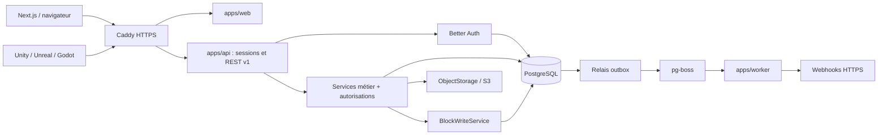

# Memoria — référence d'architecture

Version de cadrage : 2026-10-22. Public : développeur solo intermédiaire ; studios de 5 à 50 personnes. Ce document et les [ADR](docs/adr/) constituent la référence des sessions suivantes. Code en anglais, explications en français. Toute déviation significative demande un ADR mis à jour.

## Périmètre et état réel

Le MVP cible comptes, workspaces, invitations, arbre de pages, blocs usuels, bases à propriétés typées/vue tableau, recherche PostgreSQL, API publique et webhooks. SaaS et self-hosted partagent le code ; aucune dépendance à un service tiers hébergé obligatoire. Sont exclus : collaboration temps réel, kanban/calendrier, formules/rollups, facturation, mobile et blocs avancés.

| Livré dans cette session                                              | État                                                                                     |
| --------------------------------------------------------------------- | ---------------------------------------------------------------------------------------- |
| pnpm/Turbo, TypeScript strict, lint/format, hooks et `pnpm check`     | Exécutables                                                                              |
| Compose PostgreSQL, MinIO, Mailpit, Caddy                             | Configurés ; applications Node séparées                                                  |
| Schéma Drizzle, migrations et contraintes SQL                         | 37 tables ; testé sur PostgreSQL                                                         |
| Contrat de schéma Better Auth                                         | Comparé aux champs des plugins installés                                                 |
| Modèles et UI des blocs séparés, registry et `gamedev.character-card` | Validation, migration, adaptateur BlockNote, rendu différé et contrôle du graphe serveur |
| Contrats Zod API, ETag, stockage, interface du writer                 | Typés ; pas de service HTTP exécuté                                                      |
| OpenAPI de conception                                                 | Généré dans `docs/api/openapi.json`, non servi par une API                               |
| ADR et architecture                                                   | Décisions acceptées, détails d'intégration et limites explicités                         |

**Non implémentés** : bootstrap Next/Nest/worker, écrans, hooks d'auth/assurance, autorisations exécutables, repositories métier, writer SQL, blocs standard dans le catalogue, stockage S3, emails, recherche applicative, handlers REST, relais outbox, livraison/SSRF, purge et e2e HTTP. Les commentaires « contract only » et les fichiers `src/index.ts` vides sont intentionnels ; aucun module ne simule une réussite.

## Stack et frontières

- Monorepo pnpm 11.25, Turbo, Node 24, TypeScript 5.9 strict (plage compatible avec le linter), Zod 4.
- Web prévu : Next.js App Router, Tailwind, shadcn/ui, client Better Auth et BlockNote. Les dépendances d'UI applicative seront installées lors du module web.
- API prévue : NestJS Express, modules métier standards ; Better Auth hébergé dans ce processus.
- Worker prévu : pg-boss avec le même PostgreSQL, sans Redis. Les paquets d'exécution Nest/Next/pg-boss ne sont pas artificiellement installés avant leur usage.
- Données : PostgreSQL 17, Drizzle 0.45.4, Drizzle Kit 0.31.11 ; migrations SQL versionnées. Auth 1.7.12 et BlockNote 0.56.0 figés pour les contrats de cette session.



Le diagramme décrit l'architecture cible, pas des processus applicatifs déjà livrés. Les services front et publics sont identiques ; leurs contrôleurs adaptent authentification, DTO et codes HTTP. Un service reçoit un `RequestContext` vérifié ; il ne fait jamais confiance à un `workspaceId`, rôle ou acteur provenant du corps client. Les erreurs sont traduites à la frontière HTTP.

## Arborescence

```text
apps/
  web/                         # emplacement Next.js, sans routes à ce stade
  api/src/modules/blocks/
    block-write.service.ts     # contrat unique ; implémentation future
  worker/                      # emplacement des consommateurs pg-boss
packages/
  auth/src/                    # schéma des plugins et test de compatibilité
  db/
    src/schema/
      auth.ts                  # comptes, sessions, facteurs, workspaces
      common.ts                # acteurs et colonnes d'audit
      security.ts              # politiques, clés, sujets, partages
      content.ts               # pages, blocs, projection de recherche
      databases.ts             # définitions, lignes, valeurs, vues
      files.ts                 # fichiers et références
      operations.ts            # outbox, webhooks, audit, idempotence
    src/migrate.ts             # applique les migrations
    src/transaction.ts         # type de transaction Drizzle partagé
    drizzle/                   # migrations générées + SQL d'intégrité
  contracts/src/               # Zod, ETag, stockage, générateur OpenAPI
  blocks/
    core/src/                  # BlockModel et registry ; Zod uniquement
    ui/src/                    # BlockUi et contrat d'adaptateur BlockNote
    catalog/src/
      server.ts                # modèles uniquement : API, worker, imports
      client.ts                # UI, menu et schéma BlockNote
      server-boundary.test.ts  # contrôle des dépendances transitives
    character-card/src/
      model.ts                 # export /model : schéma, migration, texte
      ui.ts                    # export /ui : menu et loaders
      adapter.ts               # conversions vers/depuis les props BlockNote
      editor.tsx, readonly.tsx # modules de rendu chargés à la demande
infra/
  caddy/Caddyfile
  minio/Dockerfile              # construction locale de la version corrigée
scripts/                       # génération .env, contrôle index, test PostgreSQL
docs/
  adr/001-... à 013-...
  api/openapi.json             # contrat de conception généré
  reviews/                     # résumé de relecture à chaque livraison
ARCHITECTURE.md
compose.yaml
lefthook.yml
pnpm-workspace.yaml
turbo.json
```

À créer pendant les modules suivants : `apps/api/src/modules/{auth,workspaces,authorization,pages,databases,files,search,public-api,webhooks,audit}`, `apps/web/src/app`, `apps/web/src/components`, `apps/worker/src/jobs`, `packages/blocks/standard` et tests e2e. Ne créer un package supplémentaire que si une dépendance partagée réelle le justifie.

## Authentification et autorisation

Better Auth gère email/mot de passe avec vérification, TOTP/codes de secours, passkeys et memberships. Les passkeys peuvent être multiples, nommées et supprimées. Le plugin organization est utilisé avec rôles personnalisés, pas avec des rôles fournis par le client. Le plugin api-key est utilisé pour les credentials ; les politiques complémentaires appartiennent à Memoria. Voir [ADR 003](docs/adr/003-better-auth.md).

| Principal | Contenu                                                                      | Gestion des accès                                                         |
| --------- | ---------------------------------------------------------------------------- | ------------------------------------------------------------------------- |
| owner     | lecture/édition de tout le workspace                                         | toutes, transfert ; protéger le dernier owner                             |
| admin     | lecture/édition de tout le workspace                                         | membres/partages, sans transfert de propriété ni suppression du workspace |
| member    | lecture/édition de tout le workspace                                         | pas de gestion des rôles/partages                                         |
| guest     | pages partagées et descendants, niveau read/edit par partage                 | aucune                                                                    |
| clé API   | scopes ∩ droits actuels de son émetteur ∩ restrictions éventuelles de la clé | aucun pouvoir de gestion via `/v1` au MVP                                 |

Un partage edit permet la mise à jour de la page, de ses blocs et de ses valeurs de ligne, pas la modification des propriétés globales de sa base. Une clé devient inutilisable si son émetteur est retiré ; réduire son rôle réduit immédiatement ses droits. Les changements de droits ne sont pas mis en cache sans invalidation. Aucune page privée pour les membres au MVP ; tables sujet/ressource/niveau extensibles.

Une preuve `session_assurance` est issue d'une vérification serveur réelle. Le caractère frais d'une session Better Auth et `twoFactorEnabled` ne sont pas des preuves suffisantes. Exiger TOTP ou passkey UV pour les actions sensibles ; les codes de secours donnent uniquement le parcours de récupération. Voir [ADR 004](docs/adr/004-connexion-forte.md) pour le correctif d'intégration UV indispensable dans la version du plugin inspectée.

L'obligation de connexion forte est configurable par workspace avec délai individuel de grâce. Les sessions faibles existantes ne sont pas promues lorsqu'un facteur est simplement enregistré : elles doivent effectuer une vérification. Après échéance, vérifier la preuve forte sur les sessions qui accèdent au contenu. Les clés API restent des credentials de machine : créées après preuve forte récente, elles ne demandent pas un TOTP à chaque appel ; leur politique vérifie encore l'adhésion, les scopes, la révocation et la présence d'un facteur si le workspace l'impose. Le propriétaire doit posséder un facteur vérifié et une preuve fraîche avant activation.

## Inventaire de données

Le schéma exécutable fait foi : [index Drizzle](packages/db/src/schema/index.ts). Les noms natifs Better Auth sont conservés côté TypeScript, par exemple `member.organizationId` désigne SQL `workspace_id`.

| Domaine                | Tables SQL                                                                                                                                            |
| ---------------------- | ----------------------------------------------------------------------------------------------------------------------------------------------------- |
| Identité globale       | auth_users, auth_accounts, auth_sessions, auth_verifications, auth_two_factors, auth_passkeys, auth_rate_limits, session_assurance                    |
| Workspaces             | workspaces, workspace_members, workspace_invitations, workspace_policies                                                                              |
| Autorisations et audit | actors, access_subjects, access_grants, api_keys, api_key_policies, audit_logs                                                                        |
| Contenu                | pages, blocks, search_documents                                                                                                                       |
| Bases                  | databases, database_rows, database_properties, property_options, property_values, multi_select_values, person_values, relation_values, database_views |
| Fichiers               | files, file_references                                                                                                                                |
| Asynchrone             | outbox_events, webhook_endpoints, webhook_deliveries, webhook_attempts, idempotency_records                                                           |

pg-boss crée et migre ses propres tables dans un schéma dédié lors de son module. Ne pas les recopier dans Drizzle.

Les FK composites empêchent les références entre workspaces et garantissent qu'un bloc enfant appartient à la même page. Les migrations incluent ordre unique des frères vivants, types de valeurs, cycles d'arbres, cohérence credential/politique, identité tenant immuable et mise à jour de `updated_at`. Les champs JSONB sont validés par Zod avant écriture ; les contraintes SQL ne remplacent pas ces validations.

Invariants restant à coder dans les services : aucun ancêtre archivé visible, row page sous la page de sa base, page hôte de base différente d'une ligne, hiérarchie autorisée, propriété/option/membre non supprimé, date/fuseau valides, bornes de tailles/profondeur, suppression du dernier owner interdite et version changée pour chaque mutation observable. Une page ne peut être simultanément hôte d'une base et ligne. Un changement de type de propriété peuplée ou de base d'une ligne est refusé au MVP.

Les dates sont des `timestamptz` sauf dates civiles ; nombres exacts en chaînes décimales côté API. Les contenus sont JSON structurés sans HTML exécutable. Les détails sur filtres et tris se trouvent dans [ADR 008](docs/adr/008-proprietes-typees.md).

## Transaction d'écriture et concurrence

1. Authentifier, construire le contexte et vérifier membership/scopes/partage/assurance.
2. Ouvrir la transaction ; prendre le verrou de workspace pour les changements d'arbre et les verrous de pages dans un ordre stable. Revalider les autorisations sous ces verrous pour sérialiser avec les changements de partages/rôles.
3. Vérifier idempotence et préconditions ; CAS sur la version de page. Ne pas faire seulement un SELECT de version suivi d'un UPDATE inconditionnel.
4. Appeler **une seule fois** le writer pour le batch de blocs ; exécuter les autres écritures métier dans la même transaction.
5. Mettre à jour la projection de recherche, les références de fichiers, l'audit, l'outbox et la réponse d'idempotence ; commit.

Toutes les écritures de blocs passent par ce service, y compris les imports futurs, migrations de contenus et purges. Les migrations SQL de structure et fixtures de tests sont les exceptions. Le worker de rétention appelle le writer ; il n'émet pas un DELETE direct sur `blocks`. Les transactions n'effectuent ni appel HTTP webhook ni upload S3.

Le front vérifie la version périodiquement (15 s, page visible), au retour de focus et avant sauvegarde ; un conflit conserve le brouillon. Le front reçoit 409, l'API publique 412 pour un If-Match périmé et 428 sans précondition. Les rangs sont calculés côté serveur avec fractional indexing et comparés en ordre binaire. Voir [ADR 006](docs/adr/006-arbres-et-versions.md).

## Contrat des blocs et exemple

[`BlockModel`](packages/blocks/core/src/definition.ts) expose uniquement `type`, `version`, `schema`, `createDefault`, `migrate`, `toPlainText`. `@memoria/blocks-core` ne dépend que de Zod, sans React ni BlockNote. Le registry refuse doublons, types inconnus, versions futures et données invalides ; il ne connaît ni menus ni loaders.

[`BlockUi`](packages/blocks/ui/src/index.ts), dans le package distinct `@memoria/blocks-ui`, référence le modèle et expose `menu`, `loadEditor`, `loadReadonly`. Le module éditeur chargé fournit l'adaptateur BlockNote : `spec`, `editorType`, `toEditorProps`, `fromEditorProps`. L'UI importe le modèle, jamais l'inverse.

| Consommateur                              | Entrées autorisées                                                                         |
| ----------------------------------------- | ------------------------------------------------------------------------------------------ |
| NestJS, worker, recherche, futurs imports | `@memoria/block-catalog/server`, `@memoria/blocks-core`, exports `/model` des blocs        |
| Éditeur et rendu web                      | `@memoria/block-catalog/client`, `@memoria/blocks-ui`, exports `/ui` et `/model` des blocs |

Chaque package de bloc expose exactement `./model` et `./ui` ; le catalogue expose `./server` et `./client`. Aucun export racine ne mélange les deux. Les anciens `BlockDefinition`, imports racine des blocs/catalogue et `/editor` sont supprimés : les consommateurs doivent choisir leur entrée explicitement.

Le [test de frontière serveur](packages/blocks/catalog/src/server-boundary.test.ts) suit les imports/réexports transitifs et types avec TypeScript, puis les dépendances JavaScript avec esbuild, imports dynamiques inclus et élimination du code inutilisé désactivée. Il échoue si React, ses runtimes, React DOM ou `@blocknote/*` deviennent accessibles depuis l'export public `/server`. Il contrôle aussi le manifeste de `blocks-core`. Des scénarios négatifs vérifient que cette protection détecte une régression indirecte. esbuild sert ici aux tests ; le build NestJS reste à décider en session 1.

Un bloc inconnu lu doit être affiché comme élément préservé et non éditable ; ne jamais le remplacer silencieusement par un paragraphe. Les imports de types inconnus sont rejetés ou mis en quarantaine, sans écriture partielle.

La convention de contenu des blocs standard à intégrer en session 2 est :

| Type API                | Contenu métier                     | Adaptateur BlockNote prévu          |
| ----------------------- | ---------------------------------- | ----------------------------------- |
| core.paragraph          | spans texte/liens et styles bornés | paragraph                           |
| core.heading            | level 1–3, spans                   | heading                             |
| core.bullet-list-item   | spans                              | bulletListItem                      |
| core.numbered-list-item | spans                              | numberedListItem                    |
| core.todo               | checked, spans                     | checkListItem                       |
| core.code               | language, code                     | codeBlock                           |
| core.image              | fileId, alt, caption, largeur      | image via URL de lecture temporaire |
| core.divider            | objet vide                         | bloc séparateur                     |

Un span est du texte avec styles autorisés (bold, italic, underline, strike, code) ou un lien HTTP(S) contenant des spans texte. Jamais de HTML brut ni de dépendance à un composant React dans les données. Les enfants et leur ordre appartiennent à l'enveloppe, pas au JSON de contenu. Les validateurs/adaptateurs standard ne sont pas implémentés dans cette session.

L'exemple `gamedev.character-card` fournit le [modèle](packages/blocks/character-card/src/model.ts) et son [UI](packages/blocks/character-card/src/ui.ts). V1 `{characterId,name,description}` migre vers V2 ; `characterId` est conservé pour les références dans un moteur. Le transport BlockNote utilise une prop primitive sérialisée, immédiatement reconvertie en objet validé avant persistance : l'API ne retourne pas ce JSON encodé dans une chaîne.

```json
{
  "id": "996208b2-4a76-4c35-bb14-b27731fc8417",
  "parentId": null,
  "position": "a0",
  "type": "gamedev.character-card",
  "schemaVersion": 2,
  "content": {
    "characterId": "596208b2-4a76-4c35-bb14-b27731fc8417",
    "displayName": "Mira",
    "archetype": "npc",
    "biography": "Forest guardian",
    "health": 100,
    "attack": 10,
    "tags": ["forest"]
  }
}
```

Pour ajouter un bloc : créer son package avec exports `/model` et `/ui`, définir schéma/migrations et UI/adaptateur séparément, enregistrer le modèle dans le [catalogue serveur](packages/blocks/catalog/src/server.ts), puis son UI et sa spec dans le [catalogue client](packages/blocks/catalog/src/client.ts). Le cœur ne change pas. Un test compare les modèles des deux catalogues pour détecter un oubli.

Le catalogue d'exemple contient seulement character-card ; `createExampleEditorSchema` réunit le paragraphe natif de BlockNote et la carte pour démontrer l'intégration. L'adaptation des blocs standard au format API Memoria reste à faire. Les modules editor/readonly sont importés dynamiquement uniquement depuis `/ui` ; charger les specs nécessaires avant d'instancier l'éditeur. `createExampleSlashItems` produit les actions d'insertion à partir de `blockUis` ; le futur module web les raccordera au contrôleur de menu `/` et rendra les clés d'icône. Voir [ADR 007](docs/adr/007-blocs-registry-yjs.md).

## API, outbox et intégrations

[`packages/contracts`](packages/contracts/src/index.ts) contient DTO Zod, format d'erreur, types des valeurs, opérations de blocs, ETag et interface S3. Générer OpenAPI avec `pnpm openapi:generate`, puis `pnpm format`. Les endpoints de base pages/blocs/rows/recherche sont décrits ; les routes fichiers, propriétés et filtres/vues seront précisées pendant leur module. Le document indique explicitement son statut `1.0.0-design`. Aucun endpoint n'est servi pour l'instant.

L'API utilise des clés workspace, scopes et droits courants de l'émetteur. Pagination par curseur signé, idempotence transactionnelle des POST, préconditions de page et format d'erreur unique : [ADR 009](docs/adr/009-api-publique.md). Les moteurs reçoivent UUID, noms de types, versions et objets JSON indépendants de BlockNote.

Outbox transactionnel → relais → pg-boss → livraisons. Au moins une fois ; les consommateurs dédupliquent par event ID. HMAC sur les octets réellement envoyés, retries bornés, journal des tentatives sans données sensibles, désactivation après échecs et protection SSRF à chaque tentative. Les destinations LAN sont autorisées par l'exploitant self-hosted seulement. Voir [ADR 010](docs/adr/010-outbox-webhooks.md).

## Déploiement, données personnelles et exploitation

Une origine derrière Caddy en local comme en production. Cookies host-only Secure/HttpOnly, `SameSite=Lax`, origines explicitement autorisées ; aucun CORS permissif ni partage de cookies par défaut. La variante deux sous-domaines est documentée mais non implémentée. SMTP configurable requis en production, Mailpit en développement ; liens d'invitation copiables dans la future interface. Voir [ADR 005](docs/adr/005-origine-cookies-deploiement.md).

L'interface S3 n'impose pas de fournisseur hébergé. MinIO est réservé au développement en raison de l'archivage du dépôt communautaire ; le Dockerfile construit une version corrigée et vérifiée. La production doit sélectionner un endpoint S3 maintenu. Bucket privé, uploads bornés, références par ID et URLs courtes : [ADR 011](docs/adr/011-fichiers-recherche.md).

Par défaut : corbeille 30 j ; événements/livraisons terminales 30 j ; audit 90 j ; idempotence 24 h ; jobs terminés 7 j. Variables d'environnement puis paramètres workspace, avec bornes d'exploitation. Les logs actifs/non livrés ne sont pas supprimés prématurément. Purges à implémenter, y compris objets S3 et sauvegardes. La suppression de compte révoque l'accès, efface les données d'identité et anonymise les références d'audit ; le dernier owner doit transférer son workspace. Les contributions communes sont conservées sans identité d'auteur. Voir [ADR 012](docs/adr/012-corbeille-conservation.md).

## Commandes et preuves attendues

```sh
pnpm install --frozen-lockfile
pnpm hooks:install
pnpm env:init
pnpm infra:up
pnpm check
pnpm test:db
pnpm db:migrate
pnpm openapi:generate
```

`env:init` refuse d'écraser un `.env` existant et n'affiche aucun secret. Les détails de confiance du certificat Caddy sont dans le [README](README.md). Les tests PostgreSQL utilisent un schéma éphémère nommé aléatoirement et le suppriment ensuite ; `db:migrate` applique volontairement les migrations à la base configurée. Ne pas lancer de reset global de la base pour tester.

Les tests actuels couvrent types/schémas des plugins, registre/migration et transport du bloc, absence de dépendances UI dans le graphe serveur, cohérence des catalogues, formes API/ETag/idempotence OpenAPI et contraintes PostgreSQL. Les 6 tests SQL sont ignorés par `pnpm test` sans `TEST_DATABASE_URL` ; `pnpm test:db` les lance explicitement. Ils ne sont pas des tests e2e HTTP. À l'arrivée de chaque module, ajouter les tests de ses risques réels : accès guest/clé, course de versions, rollback outbox, retries/dédoublonnage, UV absent, grâce et actions sensibles, DNS rebinding et purge. `pnpm check` doit passer avant chaque commit.

## Sessions suivantes

Objectif : obtenir une tranche verticale utilisable rapidement et vérifier les risques techniques tôt. **Aucun utilisateur réel avant la fin de la session 3.** Les tables et contrats de sécurité déjà présents décrivent la cible ; ils n'activent pas les fonctionnalités des sessions ultérieures.

1. **Socle exécutable et connexion simple.** Vérifier **en premier**, avant les écrans et l'authentification, que NestJS consomme les packages du monorepo exportant du TypeScript source : décorateurs, injection et métadonnées, compilation et démarrage du résultat construit, y compris un import du catalogue `/server`. Consigner la solution retenue, ses réglages de build et les commandes de reproduction dans un nouvel ADR. Puis bootstrap NestJS, Next.js et worker démarrables derrière Caddy ; Better Auth email/mot de passe, vérification d'email via Mailpit, création de workspace et écrans minimaux. Pas encore de TOTP, passkeys ni de logique `session_assurance`.
2. **Pages et éditeur.** Arbre de pages, implémentation réelle de `BlockWriteService`, blocs standard et recherche synchrone. Adaptateurs BlockNote aller-retour testés, **blocs imbriqués inclus**, identifiants et ordre préservés. Autosave, polling de version et gestion des conflits conservant le brouillon. Autorisations limitées à **owner/member** ; aucun invité ou partage actif à ce stade.
3. **Connexion forte.** TOTP, passkeys avec contrôle UV côté serveur, `session_assurance`, politique de workspace et délai de grâce, preuve forte récente pour les actions sensibles. Tests d'absence d'UV, de preuves expirées et d'enrôlement sans promotion automatique de session. Cette session doit être terminée avant tout accès d'utilisateurs réels.
4. **Invités et partages.** Invitations SMTP et liens copiables, rôles de gestion owner/admin, accès explicites read/edit hérités par les descendants, révocation et protection des changements de rôle. Appliquer les mêmes règles à la recherche ; préparer leur réutilisation par l'API publique.
5. **Bases.** Propriétés typées, filtres/tris et vue tableau, relations/personnes autorisées.
6. **Fichiers.** Implémentation S3, signatures, finalisation, limites et nettoyage.
7. **API publique.** Façades `/v1`, scopes, rate limiting, idempotence, ETag/If-Match et 412, OpenAPI servi et e2e contre Compose.
8. **Jobs, webhooks et rétention.** Relais, livraisons, protection SSRF, gestion des secrets, purge configurable de la corbeille et suppression de compte/données.

Chaque session utilise sa branche de module, met à jour cette référence et se termine par des contrôles et petits commits. Le développeur effectue les merges après relecture. Cette correction reste sur `feat/architecture` ; elle ne démarre pas la session 1 et ne prétend pas avoir validé le build NestJS.

## Relecture de chaque livraison

Ajouter à la fin de chaque session un fichier dans `docs/reviews/`, en langage simple, avec trois repères : **fichiers à lire en priorité**, **ce qui pourrait casser**, **comment tester manuellement**. Préciser les résultats des contrôles et ce qui reste non exécutable. Reprendre ces repères dans la réponse de livraison.

Pour cette correction : [séparation du modèle et de l'interface des blocs](docs/reviews/architecture-block-model-ui.md).
