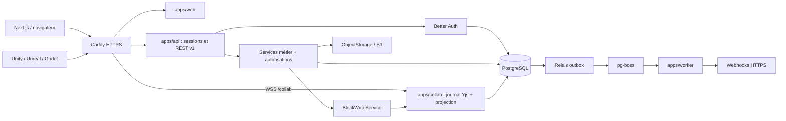
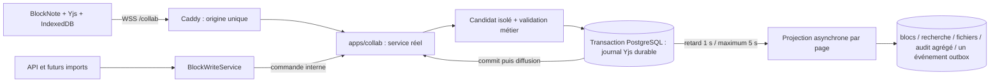

# Memoria — référence d'architecture

État après session 3c, présence et cache local : 2026-10-24. Public : développeur solo intermédiaire ; studios de 5 à 50 personnes. Ce document et les [ADR](docs/adr/) constituent la référence des sessions suivantes. Code en anglais, explications en français. Toute déviation significative demande un ADR mis à jour. L'[ADR 017](docs/adr/017-collaboration-temps-reel.md) est accepté ; service, éditeur, présence et cache collaboratifs sont intégrés. La capacité mémoire reste en 3d, sur une nouvelle branche après fusion de 3c, obligatoire avant la session 4. La finition de l'interface précède aussi les premiers utilisateurs réels.

## Périmètre et état réel

Le MVP cible comptes, workspaces, collaboration temps réel, invitations, arbre de pages, blocs usuels, bases à propriétés typées/vue tableau, recherche PostgreSQL, API publique et webhooks. SaaS et self-hosted partagent le code ; aucune dépendance à un service tiers hébergé obligatoire. Sont exclus : kanban/calendrier, formules/rollups, facturation, mobile et blocs avancés. La collaboration entre au périmètre en session 3, avant la connexion forte.

| Livré après la session 3c                                             | État                                                                                                                                                        |
| --------------------------------------------------------------------- | ----------------------------------------------------------------------------------------------------------------------------------------------------------- |
| pnpm/Turbo, TypeScript strict, lint/format, hooks et `pnpm check`     | Exécutables                                                                                                                                                 |
| Compose PostgreSQL, MinIO, Mailpit, Caddy                             | Configurés ; applications Node séparées                                                                                                                     |
| Schéma Drizzle, migrations et contraintes SQL                         | 44 tables ; testé sur PostgreSQL                                                                                                                            |
| Contrat de schéma Better Auth                                         | Comparé aux champs des plugins installés                                                                                                                    |
| Modèles et UI des blocs séparés, registry et `gamedev.character-card` | Validation, migration, adaptateur BlockNote, rendu différé et contrôle du graphe serveur                                                                    |
| Contrats Zod API, ETag, stockage, writer transactionnel               | Routes de session pages/blocs/recherche actives ; API publique ultérieure                                                                                   |
| Pages et éditeur BlockNote                                            | Provider Hocuspocus, reçus durables, WSS Caddy, fusion hors ligne et fiches par champ                                                                       |
| Présence et cache local                                               | Curseurs/noms vérifiés, couleurs stables ; IndexedDB par utilisateur/page/génération, fermeture/reprise, effacement et protection des onglets retardataires |
| Autorisations et recherche                                            | Owner/member ; projection asynchrone ; aucun contenu sous un ancêtre archivé                                                                                |
| Bootstrap NestJS / Next.js / worker pg-boss                           | Build et démarrage derrière Caddy vérifiés ; métadonnées Nest conservées                                                                                    |
| Connexion email/mot de passe et workspaces                            | Email Mailpit, vérification, session et création transactionnelle fonctionnels                                                                              |
| Tests HTTP session 1                                                  | Origine HTTPS réelle, cookies, CSRF, isolation, concurrence et déconnexion                                                                                  |
| OpenAPI de conception                                                 | Généré dans `docs/api/openapi.json`, non servi par une API                                                                                                  |
| ADR et architecture                                                   | Décisions acceptées, détails d'intégration et limites explicités                                                                                            |

**Non implémentés** : capacité mémoire 3d, finition de l'interface, bases, livraison des fichiers S3, facteurs forts et `session_assurance`, récupération de mot de passe, invitations/partages, API publique, relais outbox, livraison/SSRF et jobs de rétention. La purge de contenu devra passer par le service collaboratif en session 9 ; aucun job de rétention n'est planifié. L'image est un emplacement avec métadonnées, en attendant la session 7. Le worker initialise pg-boss et vérifie PostgreSQL, sans job métier fictif. Aucun utilisateur réel avant la fin de la session 4 et la finition de l'interface.

## Stack et frontières

- Monorepo pnpm 11.25, Turbo, Node 24, TypeScript 5.9 strict (plage compatible avec le linter), Zod 4.
- Web : Next.js 16.4.2 App Router, React 19.3.1, Tailwind 4.3.3 et client Better Auth. Éditeur BlockNote 0.56 avec son intégration Mantine, chargé seulement côté client ; arbre et contrôles simples en React.
- API : NestJS 12.2 / Express 5, modules auth/workspaces/pages/blocs ; Better Auth hébergé dans ce processus. Transformation TypeScript puis bundling ESM pour consommer les exports source : [ADR 014](docs/adr/014-build-serveur-typescript-source.md).
- Worker : pg-boss 12.38 avec le même PostgreSQL dans son schéma dédié, sans Redis. Sonde de disponibilité sur `/api/health/worker` derrière Caddy.
- Données : PostgreSQL 17, Drizzle 0.45.4, Drizzle Kit 0.31.11 ; migrations SQL versionnées. Auth 1.7.12 et BlockNote 0.56.0 figés pour les contrats de cette session.



Le diagramme décrit le socle et les intégrations prévues : web/API/auth/workspaces/pages, writer et processus worker existent ; relais, webhooks et stockage restent à implémenter. Le backend et l'éditeur collaboratif communiquent via WSS sur la même origine. Les services front et publics partagent les règles métier ; leurs contrôleurs adaptent authentification, DTO et codes HTTP. Un service reçoit un contexte vérifié ; il ne fait jamais confiance à un rôle ou acteur provenant du corps client. Le workspace de l'URL est vérifié contre les droits courants. Les erreurs sont traduites à la frontière HTTP.

### Collaboration : service 3a, éditeur 3b, présence et cache 3c

L'[ADR 017](docs/adr/017-collaboration-temps-reel.md) retient `apps/collab`, Hocuspocus 4.7.1 mono-instance sans Redis. `pnpm dev/build/start` inclut désormais ce processus. Le backend reçoit les WebSockets sur le port privé 3003 et les commandes HMAC sur 3004. Caddy route /collab vers 3003 et le front utilise le provider Hocuspocus ; 3004 reste privé. Le mode read est testé avec une fixture ; les invités arrivent en session 5. Les douze scénarios de la preuve ciblent le service réel ; `proof/` et ses anciens lanceurs ont été supprimés.



Yjs est la référence du corps. Avant diffusion : droits, limites, candidat codec/Zod et commit du journal sous verrou de page uniquement. Les projections sont regroupées après environ 1 s d'inactivité, au plus 5 s en frappe continue ; leurs erreurs sont réessayées sans suspendre la saisie. Un audit par auteur/page/fenêtre et un seul outbox portant la révision ; le writer hors éditeur attend sa propre projection. Le codec et les modèles serveur restent sans UI. Titre, arbre, déplacements et archivage restent relationnels avec 409. Fiche personnage par champ, saisie hors ligne dans une page déjà ouverte et fermeture de secours sous 5 s sont acceptées. Limites : 20 salles/utilisateur, 500 sockets/instance. Un reset ciblé des données de test sans conversion est disponible ; les anciens brouillons JSON sont effacés au premier chargement de 3c.

La validation incrémentale conserve une réplique isolée ; seuls les contenus touchés repassent codec/Zod, les invariants globaux restent contrôlés. Les bornes binaires sont **1 Mio** (document et update), 500 blocs et profondeur 50. Le budget de répliques configurable remplace la borne de 100 documents : **1 Gio par défaut**, réservations prudentes de 192 Mio par salle (donc 5 salles résidentes au réglage par défaut), éviction inactive d'abord et après 5 minutes sans connexion. Une nouvelle salle est refusée explicitement si toutes les réservations sont actives. Ce budget n'est pas un plafond RSS de tout le processus. Voir le [dimensionnement](docs/self-hosting.md).

Les mesures du service sont archivées avec la [fiche 3a](docs/reviews/session-3-3a-service.md) : deux profils proches de 1 Mio, 30 chargements froids et 200 updates chacun. L'historique reste le cas lent ; la capacité de 50 utilisateurs actifs n'est pas démontrée. Taille encodée, taille JSON, révision mesurée et ratio sont conservés en base. Un avertissement apparaît à **768 Kio et ratio ≥ 4**. Aucun rebasage n'est activé.

**Transition explicite :** l'ancien autosave et son dialogue de conflit de contenu sont supprimés. Le provider attend le document Yjs avant de monter BlockNote et affiche « Enregistré sur le serveur » uniquement après un reçu durable correspondant aux octets envoyés. Le titre reste indépendant, avec bouton d'enregistrement, vérification périodique et conflit 409. Les anciennes pages contenant des blocs sans document Yjs renvoient `DOCUMENT_RESET_REQUIRED` : [procédure de reset ciblé](docs/reviews/session-3-3b-editor.md). Cette livraison ne réinitialise aucun ancien contenu applicatif automatiquement. Les anciens brouillons JSON passent à une base vide de version 2 : un onglet de session 2 ne peut pas recréer sa base de version 1.

**Présence et cache 3c :** noms vérifiés, couleurs stables et curseurs du texte sont diffusés par awareness, jamais journalisés. Un cache IndexedDB propre conserve les updates Yjs par utilisateur/workspace/page/génération, avec transactions contrôlant session et époque locale. « Copie locale à jour » signifie que la transaction IndexedDB est terminée ; seul le reçu réseau vaut sauvegarde serveur. Le corps hors ligne peut survivre à la fermeture de l'onglet ; rouvrir nécessite le réseau pour vérifier identité et accès avant toute lecture/rendu du cache. Le titre non enregistré reste en mémoire. La déconnexion avertit de la perte des changements non envoyés, ferme les éditeurs des autres onglets et efface toutes les données locales de l'utilisateur ; des marqueurs opaques empêchent les onglets retardataires de les recréer. Une nouvelle connexion légitime part d'un cache vide. Une erreur de stockage/effacement est affichée et peut être réessayée ; la révocation serveur est tentée même si le nettoyage échoue. Voir la [fiche 3c](docs/reviews/session-3-3c-presence-cache.md).

## Arborescence

```text
apps/
  web/src/app/                 # connexion, inscription, vérification et workspaces
  api/src/
    main.ts                    # démarrage du processus Nest
    app.ts                     # module racine, origine, parsing et erreurs HTTP
    auth.e2e.ts                # tests HTTP isolés, exclus du build de production
    bootstrap-probe.ts         # preuve compilée décorateurs + packages source
    modules/auth/              # guard global, @Public, @CurrentUser, handler et SMTP
    modules/workspaces/        # module, contrôleur et service transactionnel
    modules/blocks/
      block-write.service.ts   # façade HMAC vers la salle Yjs, attente de sa projection
    modules/pages/            # arbre, autorisations owner/member, corbeille et recherche
    pages.e2e.ts               # parcours de contenu compilé, PostgreSQL réel
  worker/src/main.ts           # pg-boss, readiness et arrêt ; jobs métier ultérieurs
  collab/src/
    main.ts                   # processus privé 3003/3004
    codec.ts                  # décodage strict sans UI
    service/                  # leadership, admission, journal, projection, mémoire
    testing/                  # vrais tests SQL/HTTP/WebSocket et mesures reproductibles
packages/
  auth/src/                    # configuration simple, schéma cible et test de compatibilité
  db/
    src/schema/
      auth.ts                  # comptes, sessions, facteurs, workspaces
      common.ts                # acteurs et colonnes d'audit
      security.ts              # politiques, clés, sujets, partages
      content.ts               # pages, blocs, projection de recherche
      databases.ts             # définitions, lignes, valeurs, vues
      files.ts                 # fichiers et références
      operations.ts            # outbox, webhooks, audit, idempotence
    src/migrate.ts             # applique les migrations
    src/transaction.ts         # type de transaction Drizzle partagé
    drizzle/                   # migrations générées + SQL d'intégrité
  contracts/src/               # Zod, ETag, stockage, générateur OpenAPI
  blocks/
    core/src/                  # BlockModel et registry ; Zod uniquement
    ui/src/                    # BlockUi et contrat d'adaptateur BlockNote
    catalog/src/
      server.ts                # modèles uniquement : API, worker, imports
      client.ts                # UI, menu et schéma BlockNote
      server-boundary.test.ts  # contrôle des dépendances transitives
    character-card/src/
      model.ts                 # export /model : schéma, migration, texte
      ui.ts                    # export /ui : menu et loaders
      adapter.ts               # conversions vers/depuis les props BlockNote
      editor.tsx, readonly.tsx # modules de rendu chargés à la demande
infra/
  caddy/Caddyfile
  minio/Dockerfile              # construction locale de la version corrigée
scripts/                       # lanceurs/builds, génération .env, tests SQL et HTTP
docs/
  adr/001-... à 017-...        # 017 accepté ; service/éditeur/cache livrés, 3d à venir
  api/openapi.json             # contrat de conception généré
  reviews/                     # résumé de relecture à chaque livraison
ARCHITECTURE.md
compose.yaml
lefthook.yml
pnpm-workspace.yaml
turbo.json
```

À créer pendant les modules suivants : `apps/api/src/modules/{authorization,databases,files,public-api,webhooks,audit}`, `apps/worker/src/jobs` et les tests des nouveaux parcours. La recherche de pages reste dans le module pages tant qu'un service partagé n'est pas nécessaire. Ne créer un package supplémentaire que si une dépendance partagée réelle le justifie.

## Authentification et autorisation

**Actif en session 1.** Email/mot de passe (12–128 caractères), email vérifié obligatoire, lien valable une heure, renvoi depuis le front, connexion/déconnexion. Routes de gestion organization fermées au HTTP direct ; création/listage via Nest, avec membership propriétaire et références initialisés dans une transaction. Seuls owner/member sont configurés dans le plugin. Voir [ADR 015](docs/adr/015-authentification-simple-et-workspaces.md). La politique ci-dessous décrit la cible des sessions suivantes ; TOTP, passkeys, assurance, clés et partages ne sont pas activés.

Better Auth gère email/mot de passe avec vérification, TOTP/codes de secours, passkeys et memberships. Les passkeys peuvent être multiples, nommées et supprimées. Le plugin organization est utilisé avec rôles personnalisés, pas avec des rôles fournis par le client. Le plugin api-key est utilisé pour les credentials ; les politiques complémentaires appartiennent à Memoria. Voir [ADR 003](docs/adr/003-better-auth.md).

| Principal | Contenu                                                                      | Gestion des accès                                                         |
| --------- | ---------------------------------------------------------------------------- | ------------------------------------------------------------------------- |
| owner     | lecture/édition de tout le workspace                                         | toutes, transfert ; protéger le dernier owner                             |
| admin     | lecture/édition de tout le workspace                                         | membres/partages, sans transfert de propriété ni suppression du workspace |
| member    | lecture/édition de tout le workspace                                         | pas de gestion des rôles/partages                                         |
| guest     | pages partagées et descendants, niveau read/edit par partage                 | aucune                                                                    |
| clé API   | scopes ∩ droits actuels de son émetteur ∩ restrictions éventuelles de la clé | aucun pouvoir de gestion via `/v1` au MVP                                 |

Un partage edit permet la mise à jour de la page, de ses blocs et de ses valeurs de ligne, pas la modification des propriétés globales de sa base. Une clé devient inutilisable si son émetteur est retiré ; réduire son rôle réduit immédiatement ses droits. Les changements de droits ne sont pas mis en cache sans invalidation. Aucune page privée pour les membres au MVP ; tables sujet/ressource/niveau extensibles.

Une preuve `session_assurance` est issue d'une vérification serveur réelle. Le caractère frais d'une session Better Auth et `twoFactorEnabled` ne sont pas des preuves suffisantes. Exiger TOTP ou passkey UV pour les actions sensibles ; les codes de secours donnent uniquement le parcours de récupération. Voir [ADR 004](docs/adr/004-connexion-forte.md) pour le correctif d'intégration UV indispensable dans la version du plugin inspectée.

L'obligation de connexion forte est configurable par workspace avec délai individuel de grâce. Les sessions faibles existantes ne sont pas promues lorsqu'un facteur est simplement enregistré : elles doivent effectuer une vérification. Après échéance, vérifier la preuve forte sur les sessions qui accèdent au contenu. Les clés API restent des credentials de machine : créées après preuve forte récente, elles ne demandent pas un TOTP à chaque appel ; leur politique vérifie encore l'adhésion, les scopes, la révocation et la présence d'un facteur si le workspace l'impose. Le propriétaire doit posséder un facteur vérifié et une preuve fraîche avant activation.

## Inventaire de données

Le schéma exécutable fait foi : [index Drizzle](packages/db/src/schema/index.ts). Les noms natifs Better Auth sont conservés côté TypeScript, par exemple `member.organizationId` désigne SQL `workspace_id`.

| Domaine                | Tables SQL                                                                                                                                                                        |
| ---------------------- | --------------------------------------------------------------------------------------------------------------------------------------------------------------------------------- |
| Identité globale       | auth_users, auth_accounts, auth_sessions, auth_verifications, auth_two_factors, auth_passkeys, auth_rate_limits, session_assurance                                                |
| Workspaces             | workspaces, workspace_members, workspace_invitations, workspace_policies                                                                                                          |
| Autorisations et audit | actors, access_subjects, access_grants, api_keys, api_key_policies, audit_logs                                                                                                    |
| Collaboration          | collaboration_documents, collaboration_updates, collaboration_receipts, collaboration_block_ids, collaboration_leadership, collaboration_nonces, collaboration_projection_commits |
| Contenu                | pages, blocks, search_documents                                                                                                                                                   |
| Bases                  | databases, database_rows, database_properties, property_options, property_values, multi_select_values, person_values, relation_values, database_views                             |
| Fichiers               | files, file_references                                                                                                                                                            |
| Asynchrone             | outbox_events, webhook_endpoints, webhook_deliveries, webhook_attempts, idempotency_records                                                                                       |

pg-boss crée et migre ses propres tables dans un schéma dédié lors de son module. Ne pas les recopier dans Drizzle.

Les FK composites empêchent les références entre workspaces et garantissent qu'un bloc enfant appartient à la même page. Les migrations incluent ordre unique des frères vivants, types de valeurs, cycles d'arbres, cohérence credential/politique, identité tenant immuable et mise à jour de `updated_at`. Les champs JSONB sont validés par Zod avant écriture ; les contraintes SQL ne remplacent pas ces validations.

Invariants restant à coder dans les services : aucun ancêtre archivé visible, row page sous la page de sa base, page hôte de base différente d'une ligne, hiérarchie autorisée, propriété/option/membre non supprimé, date/fuseau valides, bornes de tailles/profondeur, suppression du dernier owner interdite et version changée pour chaque mutation observable. Une page ne peut être simultanément hôte d'une base et ligne. Un changement de type de propriété peuplée ou de base d'une ligne est refusé au MVP.

Les dates sont des `timestamptz` sauf dates civiles ; nombres exacts en chaînes décimales côté API. Les contenus sont JSON structurés sans HTML exécutable. Les détails sur filtres et tris se trouvent dans [ADR 008](docs/adr/008-proprietes-typees.md).

## Écritures de contenu et opérations relationnelles

Le journal collaboratif prend uniquement le verrou de sa page et le verrou de fencing du leadership. Il revalide les droits en base, réserve les UUID de blocs, puis écrit update/reçus/révision et échéance de projection dans une même transaction. Le document vivant n'est modifié qu'après commit. Un refus de lot déclenche une revalidation individuelle ; seul le fautif est fermé. Les reçus survivent à la compaction et à l'anonymisation du compte.

Le front collaboratif passera par ce protocole. Pour toute écriture hors éditeur, `BlockWriteService` valide la commande, injecte la session authentifiée par le guard et signe la requête interne. Le worker de validation produit l'update depuis l'état Yjs courant ; la commande utilise la même file et attend sa projection. Un timeout conserve le reçu et permet un réessai idempotent. Aucun fallback SQL.

Seul le projecteur interne écrit les tables de blocs et leurs dérivés. Recherche, références, audit agrégé et un événement outbox sont commités ensemble. Une panne laisse le journal et la saisie utilisables ; curseur et retries sont persistés. L'API de lecture et la recherche exposent contentRevision/projectionRevision. Les migrations de structure et fixtures SQL restent les exceptions à la frontière d'écriture. La rétention future appellera cette façade et devra traiter aussi snapshots/journal/reçus.

Titre, arbre, déplacements et archivage conservent `pages.version` et le 409. Leurs effets de recherche partagent le mutex de projection par page, pour éviter d'écraser une projection récente avec un ancien texte. Le verrou de workspace des mutations d'arbre n'est jamais pris par le journal collaboratif. Les titres et le contenu ont donc des versions distinctes.

## Contrat des blocs et exemple

[`BlockModel`](packages/blocks/core/src/definition.ts) expose uniquement `type`, `version`, `schema`, `createDefault`, `migrate`, `toPlainText`. `@memoria/blocks-core` ne dépend que de Zod, sans React ni BlockNote. Le registry refuse doublons, types inconnus, versions futures et données invalides ; il ne connaît ni menus ni loaders.

[`BlockUi`](packages/blocks/ui/src/index.ts), dans le package distinct `@memoria/blocks-ui`, référence le modèle et expose `menu`, `loadEditor`, `loadReadonly`. Le module éditeur chargé fournit l'adaptateur BlockNote : `spec`, `editorType`, `toEditorProps`, `fromEditorProps`. L'UI importe le modèle, jamais l'inverse.

| Consommateur                              | Entrées autorisées                                                                         |
| ----------------------------------------- | ------------------------------------------------------------------------------------------ |
| NestJS, worker, recherche, futurs imports | `@memoria/block-catalog/server`, `@memoria/blocks-core`, exports `/model` des blocs        |
| Éditeur et rendu web                      | `@memoria/block-catalog/client`, `@memoria/blocks-ui`, exports `/ui` et `/model` des blocs |

Chaque package de bloc expose exactement `./model` et `./ui` ; le catalogue expose `./server` et `./client`. Aucun export racine ne mélange les deux. Les anciens `BlockDefinition`, imports racine des blocs/catalogue et `/editor` sont supprimés : les consommateurs doivent choisir leur entrée explicitement.

Le [test de frontière serveur](packages/blocks/catalog/src/server-boundary.test.ts) suit les imports/réexports transitifs et types avec TypeScript, puis les dépendances JavaScript avec esbuild, imports dynamiques inclus et élimination du code inutilisé désactivée. Il échoue si React, ses runtimes, React DOM ou `@blocknote/*` deviennent accessibles depuis l'export public `/server`. Il contrôle aussi le manifeste de `blocks-core`. Des scénarios négatifs vérifient que cette protection détecte une régression indirecte. Le build serveur ajoute le même refus des imports UI à l'exécution ; son pipeline est décrit dans l'ADR 014.

Un bloc inconnu lu doit être affiché comme élément préservé et non éditable ; ne jamais le remplacer silencieusement par un paragraphe. Les imports de types inconnus sont rejetés ou mis en quarantaine, sans écriture partielle.

La convention de contenu des blocs standard livrés en session 2 est :

| Type API                | Contenu métier                     | Adaptateur BlockNote prévu          |
| ----------------------- | ---------------------------------- | ----------------------------------- |
| core.paragraph          | spans texte/liens et styles bornés | paragraph                           |
| core.heading            | level 1–3, spans                   | heading                             |
| core.bullet-list-item   | spans                              | bulletListItem                      |
| core.numbered-list-item | spans, start nullable              | numberedListItem                    |
| core.todo               | checked, spans                     | checkListItem                       |
| core.code               | language, code                     | codeBlock                           |
| core.image              | fileId, alt, caption, largeur      | image via URL de lecture temporaire |
| core.divider            | objet vide                         | bloc séparateur                     |

Un span est du texte avec styles autorisés (bold, italic, underline, strike, code) ou un lien HTTP(S) contenant des spans texte. Jamais de HTML brut ni de dépendance à un composant React dans les données. Les enfants et leur ordre appartiennent à l'enveloppe, pas au JSON de contenu. Les validateurs/adaptateurs standard sont dans `packages/blocks/standard`, avec des tests d'aller-retour dans le vrai moteur BlockNote. Les segments adjacents de mêmes styles sont normalisés. L'image conserve son ID et ses métadonnées ; le rendu du fichier attend la session 7.

L'exemple `gamedev.character-card` fournit le [modèle](packages/blocks/character-card/src/model.ts) et son [UI](packages/blocks/character-card/src/ui.ts). V1 `{characterId,name,description}` migre vers V2 ; `characterId` est conservé pour les références dans un moteur. Le transport BlockNote utilise une prop primitive sérialisée, immédiatement reconvertie en objet validé avant persistance : l'API ne retourne pas ce JSON encodé dans une chaîne.

```json
{
  "id": "996208b2-4a76-4c35-bb14-b27731fc8417",
  "parentId": null,
  "position": "a0",
  "type": "gamedev.character-card",
  "schemaVersion": 2,
  "content": {
    "characterId": "596208b2-4a76-4c35-bb14-b27731fc8417",
    "displayName": "Mira",
    "archetype": "npc",
    "biography": "Forest guardian",
    "health": 100,
    "attack": 10,
    "tags": ["forest"]
  }
}
```

Pour ajouter un bloc : créer son package avec exports `/model` et `/ui`, définir schéma/migrations et UI/adaptateur séparément, enregistrer le modèle dans le [catalogue serveur](packages/blocks/catalog/src/server.ts), puis son UI et sa spec dans le [catalogue client](packages/blocks/catalog/src/client.ts). Le cœur ne change pas. Un test compare les modèles des deux catalogues pour détecter un oubli.

Le catalogue contient les huit modèles standard et character-card. `createEditorKit` compose le schéma concret et convertit les enveloppes en arbre BlockNote, puis en blocs avec parent/voisin. `createExampleEditorSchema` et son menu restent la petite démonstration paragraphe/carte. Les modules editor/readonly sont importés dynamiquement uniquement depuis `/ui` ; les specs sont chargées avant d'instancier l'éditeur. Le front raccorde le catalogue au menu `/` et borne la barre de formatage aux données prises en charge. Voir [ADR 007](docs/adr/007-blocs-registry-yjs.md) et [ADR 016](docs/adr/016-pages-editeur-et-sauvegarde.md).

## API, outbox et intégrations

[`packages/contracts`](packages/contracts/src/index.ts) contient DTO Zod, format d'erreur, types des valeurs, opérations de blocs, ETag et interface S3. Générer OpenAPI avec `pnpm openapi:generate`, puis `pnpm format`. Les endpoints de base pages/blocs/rows/recherche sont décrits ; les routes fichiers, propriétés et filtres/vues seront précisées pendant leur module. Le document indique explicitement son statut `1.0.0-design`. Aucun endpoint public /v1 n'est encore servi ; les routes de session, workspaces et `/api/internal/workspaces/:workspaceId/pages` et `/search` sont actives. Les quotas internes, conflits et bornes sont décrits dans l'ADR 016.

L'API utilise des clés workspace, scopes et droits courants de l'émetteur. Pagination par curseur signé, idempotence transactionnelle des POST, préconditions de page et format d'erreur unique : [ADR 009](docs/adr/009-api-publique.md). Les moteurs reçoivent UUID, noms de types, versions et objets JSON indépendants de BlockNote.

Outbox transactionnel → relais → pg-boss → livraisons. Au moins une fois ; les consommateurs dédupliquent par event ID. HMAC sur les octets réellement envoyés, retries bornés, journal des tentatives sans données sensibles, désactivation après échecs et protection SSRF à chaque tentative. Les destinations LAN sont autorisées par l'exploitant self-hosted seulement. Voir [ADR 010](docs/adr/010-outbox-webhooks.md).

## Déploiement, données personnelles et exploitation

Une origine derrière Caddy en local comme en production. Cookies host-only Secure/HttpOnly, `SameSite=Lax`, origines explicitement autorisées ; aucun CORS permissif ni partage de cookies par défaut. La variante deux sous-domaines est documentée mais non implémentée. SMTP configurable requis en production, Mailpit en développement ; liens d'invitation copiables dans la future interface. Voir [ADR 005](docs/adr/005-origine-cookies-deploiement.md).

L'interface S3 n'impose pas de fournisseur hébergé. MinIO est réservé au développement en raison de l'archivage du dépôt communautaire ; le Dockerfile construit une version corrigée et vérifiée. La production doit sélectionner un endpoint S3 maintenu. Bucket privé, uploads bornés, références par ID et URLs courtes : [ADR 011](docs/adr/011-fichiers-recherche.md).

Par défaut : corbeille 30 j ; événements/livraisons terminales 30 j ; audit 90 j ; idempotence 24 h ; jobs terminés 7 j. Variables d'environnement puis paramètres workspace, avec bornes d'exploitation. Les logs actifs/non livrés ne sont pas supprimés prématurément. Purges à implémenter, y compris objets S3 et sauvegardes. La suppression de compte révoque l'accès, efface les données d'identité et anonymise les références d'audit ; le dernier owner doit transférer son workspace. Les contributions communes sont conservées sans identité d'auteur. Voir [ADR 012](docs/adr/012-corbeille-conservation.md).

## Commandes et preuves attendues

```sh
pnpm install --frozen-lockfile
pnpm hooks:install
pnpm env:init
pnpm infra:up
pnpm check
pnpm test:bootstrap
pnpm test:db
pnpm db:migrate
pnpm build
pnpm start
# Dans un autre terminal, applications et Compose démarrés :
pnpm test:e2e
pnpm test:pages:e2e
pnpm openapi:generate
```

`env:init` refuse d'écraser un `.env` existant et n'affiche aucun secret. Les détails de confiance du certificat Caddy sont dans le [README](README.md). Les tests PostgreSQL utilisent un schéma éphémère nommé aléatoirement et le suppriment ensuite ; `db:migrate` applique volontairement les migrations à la base configurée. Ne pas lancer de reset global de la base pour tester.

Les tests actuels couvrent types/schémas des plugins, registre/migration et transport du bloc, absence de dépendances UI dans le graphe serveur, cohérence des catalogues, formes API/ETag/idempotence OpenAPI et contraintes PostgreSQL. Les conversions passent dans le vrai moteur BlockNote, enfants imbriqués inclus ; les tests des reçus couvrent la saisie pendant l'envoi, les reconnexions et les updates de suppression. Le parcours pnpm test:collab:browser vérifie deux contextes navigateur isolés via Caddy, Mailpit et PostgreSQL ; voir les fiches 3b et 3c. `pnpm check` inclut aussi la preuve Nest compilée et la validation de configuration. Les 6 tests SQL sont ignorés par `pnpm test` sans `TEST_DATABASE_URL` ; `pnpm test:db` les lance explicitement. `pnpm test:e2e` est distinct : suites Nest isolées d'authentification et de pages (droits, concurrence, rollback, recherche), puis routes session/workspace via HTTPS avec Caddy et Mailpit. Seules leurs fixtures aléatoires sont nettoyées. À l'arrivée de chaque module, ajouter les tests de ses risques réels : accès guest/clé, retries/dédoublonnage, UV absent, grâce et actions sensibles, DNS rebinding et purge. `pnpm check` doit passer avant chaque commit.

## Sessions suivantes

Objectif : obtenir une tranche verticale utilisable rapidement et vérifier les risques techniques tôt. **Aucun utilisateur réel avant la fin de la session 4 et de la Finition de l'interface**, connexion forte, quotas NAT/par compte et récupération de mot de passe inclus. Les tables et contrats de sécurité déjà présents décrivent la cible ; elles n'activent pas les fonctionnalités des sessions ultérieures.

1. **Socle exécutable et connexion simple — implémenté.** Risque NestJS/décorateurs/packages TypeScript source vérifié en premier, y compris `/server` : solution et reproduction dans l'ADR 014. Next.js, NestJS et worker démarrent derrière Caddy. Email/mot de passe, vérification Mailpit, création de workspace et écrans minimaux livrés. Aucun TOTP, passkey ou traitement `session_assurance`. Voir la fiche de relecture pour les contrôles et le prérequis du certificat navigateur.
2. **Pages et éditeur — implémenté.** Arbre de pages, `BlockWriteService` transactionnel, blocs standard et recherche synchrone. Adaptateurs BlockNote aller-retour vérifiés en premier, **blocs imbriqués inclus**, identifiants et ordre préservés. Autosave, polling de version et conflits conservant le brouillon dans IndexedDB, avec nettoyage à la déconnexion. Autorisations limitées à **owner/member** ; aucun invité ou partage actif à ce stade. L'image conserve ses métadonnées ; les fichiers restent en session 7. Limites et preuves : ADR 016 et fiche de relecture session 2.
3. **Collaboration temps réel.** La preuve incrémentale est acceptée avec borne à 1 Mio. **3a livré :** migrations, leadership PostgreSQL, quotas avant les files Hocuspocus, révocations, HMAC, BlockWriteService, projection/compaction et budget mémoire. Les douze scénarios sont permanents ; le dossier proof a été supprimé. **3b livré :** provider front, statuts d'enregistrement, WSS Caddy, reset documenté des données de test, champs séparés de character-card ; collaboration testable dans deux navigateurs. **3c livré :** présence, cache Yjs IndexedDB, effacement à la déconnexion et onglets retardataires, suppression des anciens brouillons. Chaque livraison est poussée et relue séparément.
   **Étape obligatoire avant utilisation prolongée en production :** rebasage automatique quand taille ≥ 768 Kio et ratio Yjs/JSON ≥ 4, **uniquement si la page est inoccupée**. Nouvelle génération, refus du replay hors ligne ancien et parcours d'export explicite. Tester l'absence de connexion/commande en cours sous leadership avant bascule. Cette maintenance n'est pas activée en 3a.

   **3d — Capacité mémoire de la collaboration, obligatoire avant la session 4.** Remplacer la réservation uniforme par des classes de taille fondées sur la taille encodée et le facteur d'expansion réellement mesuré ; réservation pleine uniquement près de 1 Mio. Un pool partagé de workers, dimensionné selon les cœurs, héberge plusieurs répliques par worker. La perte d'un worker impose le rechargement de ses répliques depuis PostgreSQL. Cible : **au moins 30 pages simultanément ouvertes de 200 Kio ou moins avec le budget par défaut de 1 Gio**, et **4 vCPU / 8 Gio pour toute la pile d'un studio de 50 personnes**. Refaire les mesures de capacité et mettre à jour le guide d'hébergement. Les cinq salles par Gio et les 32 Gio proposés en 3a sont un état transitoire, refusé comme dimensionnement produit. 3d n'est pas commencée en 3c : après validation de 3c, le développeur fusionnera cette branche ; 3d sera réalisée sur une nouvelle branche depuis main à jour.

4. **Connexion forte, quotas par compte et récupération de mot de passe.** Après validation de 3d : TOTP, passkeys avec contrôle UV côté serveur, `session_assurance`, politique de workspace et délai de grâce, preuve forte récente pour les actions sensibles. Étendre aussi les contrôles et révocations aux connexions collaboratives. Tests d'absence d'UV, de preuves expirées et d'enrôlement sans promotion automatique de session. Corriger les quotas d'authentification derrière un NAT de bureau : relever les limites par IP pour 50 personnes et ajouter une protection par compte contre les tentatives répétées depuis plusieurs IP (ADR 015). Ajouter la récupération de mot de passe par email, les contrôles d'abus et la révocation des sessions concernées. Cette session entière est un prérequis avant tout utilisateur réel.
   **Cache sur postes partagés :** ajouter une option « Poste partagé » à la connexion qui désactive le cache Yjs persistant pour cette session. Ajouter une politique de workspace permettant à l'administrateur d'interdire ce cache aux membres ; l'interdiction du workspace prime sur le choix individuel. Purger les copies existantes concernées et neutraliser leurs écritures depuis les onglets retardataires lors d'un changement de politique. Tester l'absence de contenu en IndexedDB, les autres onglets et la reconnexion. Cette protection sera implémentée en session 4.
   **Finition de l'interface — obligatoire avant les premiers utilisateurs réels.** Simplifier les messages d'état pour un public non technique, clarifier l'enregistrement du titre, améliorer la saisie des tags de la fiche personnage et harmoniser la présentation générale. Vérifier les parcours en ligne, hors ligne et de récupération avec ces messages. Cette étape n'est pas réalisée en 3c et ne remplace ni 3d ni la connexion forte.

5. **Invités et partages.** Invitations SMTP et liens copiables, rôles de gestion owner/admin, accès explicites read/edit hérités par les descendants, révocation et protection des changements de rôle. Appliquer les mêmes règles à la recherche et au document collaboratif, **lecture seule imposée côté serveur**, y compris lors d'une reconnexion avec cache local. Préparer leur réutilisation par l'API publique.
6. **Bases.** Propriétés typées relationnelles, filtres/tris et vue tableau, relations/personnes autorisées. Les lignes de base de données ne comptent pas dans la limite de pages du workspace et ne sont jamais chargées dans l'arborescence latérale : elles sont paginées. Définir leurs propres bornes (volume, taille et pagination) pendant cette session.
7. **Fichiers.** Implémentation S3, signatures, finalisation, limites et nettoyage.
8. **API publique.** Façades `/v1`, scopes, rate limiting, idempotence, ETag/If-Match et 412, commandes vers le document Yjs par le writer unique, OpenAPI servi et e2e contre Compose.
9. **Jobs, webhooks et rétention.** Relais, livraisons, protection SSRF, gestion des secrets, purge configurable de la corbeille et suppression de compte/données. Inclure les journaux/snapshots Yjs et les sauvegardes dans les règles de conservation.

Chaque session utilise sa branche de module, met à jour cette référence et se termine par des contrôles et petits commits. Le développeur effectue les merges après relecture, sauf autorisation explicite. Session 1 : `codex/session-1-bootstrap-auth`, fusionnée dans main. Session 2 : `codex/session-2-pages-editor`, fusionnée par la PR #2 au commit `ea9afdf`. Session 3, étape 1 : `codex/session-3-collaboration-design`, créée depuis ce main synchronisé. Chaque compte rendu d'étape fournit le hash du commit poussé, vérifié sur le dépôt distant. L'étape de cadrage se termine sans débuter l'implémentation tant que les réponses ne sont pas reçues.

## Relecture de chaque livraison

Ajouter à la fin de chaque session un fichier dans `docs/reviews/`, en langage simple, avec trois repères : **fichiers à lire en priorité**, **ce qui pourrait casser**, **comment tester manuellement**. Préciser les résultats des contrôles et ce qui reste non exécutable. Reprendre ces repères dans la réponse de livraison.

Relectures : [séparation du modèle et de l'interface des blocs](docs/reviews/architecture-block-model-ui.md), [session 1 — socle exécutable et connexion simple](docs/reviews/session-1-bootstrap-auth.md), [session 2 — pages et éditeur](docs/reviews/session-2-pages-editor.md), [session 3, étape 1 — cadrage de la collaboration](docs/reviews/session-3-etape-1-cadrage.md), [session 3, étape 2 — première preuve technique](docs/reviews/session-3-etape-2-preuve.md).

Relecture complémentaire : [session 3, étape 2 bis — tailles et dix rédacteurs](docs/reviews/session-3-etape-2bis.md).

Relecture avant 3a : [validation incrémentale, mémoire et isolation des refus](docs/reviews/session-3-validation-incrementale.md).

Relecture 3a : [service collaboratif, mémoire et mesures](docs/reviews/session-3-3a-service.md). Hébergement : [dimensionnement et limites](docs/self-hosting.md).

Relecture 3c : [présence, cache et guide de fermeture/reprise/déconnexion](docs/reviews/session-3-3c-presence-cache.md).

3d, contrôle préalable : [diagnostic des performances](docs/reviews/session-3-3d-diagnostic.md). La PR #3 est fusionnée dans main (`e38a17e`) ; travail sur `codex/session-3d-collaboration-capacity`. Premier pool arrêté sur les seuils du profil historique. Décision : conserver 1 Mio, diagnostiquer puis optimiser validation et transaction avant reprise ; capacité mémoire non encore validée.

3d, optimisations préalables : [fiche et preuves](docs/reviews/session-3-3d-optimisations.md). Plans SQL/pipeline, replay groupé et réservations incrémentales vérifiés ; froid p95 contenu/historique 296,24 / 438,81 ms. L'update historique reste à **55,68 ms**, au-dessus de 50 ms : arrêt maintenu avant le pool de production et la capacité trente pages. Mesures sur batterie, pas de qualification de l'hôte 4 vCPU / 8 Gio. Les objectifs, la borne et l'ordre des sessions restent inchangés.
