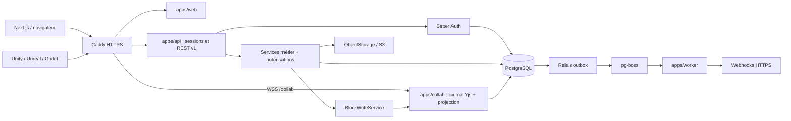
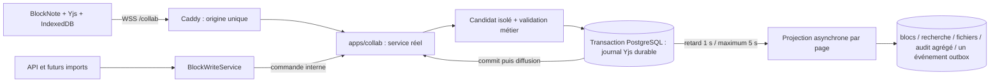

# Memoria — référence d'architecture

État au 2026-10-25 : session 4 fusionnée sur demande explicite du développeur par la [PR #5](https://github.com/FoxTimew/Memoria/pull/5), main `1fc393eb8778dad9a6480620597ef239d322ab22`. La branche `codex/session-5-guests-sharing` part de ce main synchronisé. **Session 5, étape 1 : cadrage uniquement**, sans code applicatif ; ADR [018](docs/adr/018-invitations-et-arrivee-workspace.md) et [019](docs/adr/019-partages-et-acces-collaboratif.md) proposés, avec les arbitrages reçus explicitement retenus. La session 4 comprend les facteurs testés sur Android, Windows Hello et YubiKey, les politiques, la récupération, les quotas et le cache, puis les correctifs adverses et l'optimisation SQL. La comparaison finale respecte max(10 %, 2 ms) sans retrait de contrôle ; R15 est satisfait sans dérogation. Les décisions du 25 octobre sont consignées dans la matrice 4f ; R09/R11/R13/R14 restent à traiter avant les utilisateurs réels. Public : développeur solo intermédiaire ; studios de 5 à 50 personnes. Ce document et les [ADR](docs/adr/) constituent la référence des sessions suivantes. Code en anglais, explications en français. Toute déviation significative demande un ADR mis à jour. L'[ADR 017](docs/adr/017-collaboration-temps-reel.md) est accepté ; service, éditeur, présence, cache et capacité mémoire collaboratifs sont intégrés. La finition de l'interface et la qualification dédiée à cinquante comptes précèdent aussi les premiers utilisateurs réels.

## Périmètre et état réel

Le MVP cible comptes, workspaces, collaboration temps réel, invitations, arbre de pages, blocs usuels, bases à propriétés typées/vue tableau, recherche PostgreSQL, API publique et webhooks. SaaS et self-hosted partagent le code ; aucune dépendance à un service tiers hébergé obligatoire. Sont exclus : kanban/calendrier, formules/rollups, facturation, mobile et blocs avancés. La collaboration entre au périmètre en session 3, avant la connexion forte.

| Livré après 4f                                                        | État                                                                                                                                                        |
| --------------------------------------------------------------------- | ----------------------------------------------------------------------------------------------------------------------------------------------------------- |
| pnpm/Turbo, TypeScript strict, lint/format, hooks et `pnpm check`     | Exécutables                                                                                                                                                 |
| Compose PostgreSQL, MinIO, Mailpit, Caddy                             | Configurés ; applications Node séparées                                                                                                                     |
| Schéma Drizzle, migrations et contraintes SQL                         | 55 tables ; testé sur PostgreSQL                                                                                                                            |
| Contrat de schéma Better Auth                                         | Comparé aux champs des plugins installés                                                                                                                    |
| Modèles et UI des blocs séparés, registry et `gamedev.character-card` | Validation, migration, adaptateur BlockNote, rendu différé et contrôle du graphe serveur                                                                    |
| Contrats Zod API, ETag, stockage, writer transactionnel               | Routes de session pages/blocs/recherche actives ; API publique ultérieure                                                                                   |
| Pages et éditeur BlockNote                                            | Provider Hocuspocus, reçus durables, WSS Caddy, fusion hors ligne et fiches par champ                                                                       |
| Présence et cache local                                               | Curseurs/noms vérifiés, couleurs stables ; IndexedDB par utilisateur/page/génération, fermeture/reprise, effacement et protection des onglets retardataires |
| Autorisations et recherche                                            | Owner/member ; projection asynchrone ; aucun contenu sous un ancêtre archivé                                                                                |
| Bootstrap NestJS / Next.js / worker pg-boss                           | Build et démarrage derrière Caddy vérifiés ; métadonnées Nest conservées                                                                                    |
| Connexion email/mot de passe et workspaces                            | Email Mailpit, vérification, session et création transactionnelle fonctionnels                                                                              |
| Tests HTTP session 1                                                  | Origine HTTPS réelle, cookies, CSRF, isolation, concurrence et déconnexion                                                                                  |
| OpenAPI de conception                                                 | Généré dans `docs/api/openapi.json`, non servi par une API                                                                                                  |
| ADR et architecture                                                   | Décisions acceptées, détails d'intégration et limites explicités                                                                                            |

**Livré** : capacité mémoire 3d ; comparaison alternée et trois séries à trente pages réussies, voir la [fiche 3d](docs/reviews/session-3-3d-capacite.md). La pile dédiée 4 vCPU / 8 Gio à cinquante comptes n'est pas encore qualifiée. **Validées après test manuel** : [4a](docs/reviews/session-4-4a-facteurs-assurance.md), [4b — politique et actions sensibles](docs/reviews/session-4-4b-politique-actions.md) et [4c — récupération et commande opérateur](docs/reviews/session-4-4c-recuperation.md). **Validées après test manuel** : [4d — quotas NAT et délais](docs/reviews/session-4-4d-quotas.md), cinquante comptes sur une IP, admission SQL bornée avant calcul, délais non extensibles, budgets d'email et purge des compteurs. **Également validée après test manuel** : [4e — poste partagé et politique de cache](docs/reviews/session-4-4e-cache.md). **4f fusionnée avec la session 4** : deux corrections de sécurité, attaques exécutables, décisions de risques du développeur datées du 25 octobre et optimisation SQL vérifiée ; la comparaison finale passe la marge max(10 %, 2 ms), voir la [fiche SQL et performance](docs/reviews/session-4-4f-sql-performance.md). **Non implémentés** : finition de l'interface, bases, livraison des fichiers S3, invitations/partages, API publique, relais outbox, livraison/SSRF et rétention générale. La purge de contenu devra passer par le service collaboratif en session 9. L'image est un emplacement avec métadonnées, en attendant la session 7. Le worker initialise pg-boss, traite les demandes de reset/vérification, liens chiffrés, notifications et reprises SMTP, et purge chaque minute les compteurs d'authentification inactifs. Aucun utilisateur réel avant la fin de 4a–4f, la finition de l'interface et la qualification dédiée à 50 comptes.

## Stack et frontières

- Monorepo pnpm 11.25, Turbo, Node 24, TypeScript 5.9 strict (plage compatible avec le linter), Zod 4.
- Web : Next.js 16.4.2 App Router, React 19.3.1, Tailwind 4.3.3 et client Better Auth. Éditeur BlockNote 0.56 avec son intégration Mantine, chargé seulement côté client ; arbre et contrôles simples en React.
- API : NestJS 12.2 / Express 5, modules auth/workspaces/pages/blocs ; Better Auth hébergé dans ce processus. Transformation TypeScript puis bundling ESM pour consommer les exports source : [ADR 014](docs/adr/014-build-serveur-typescript-source.md).
- Worker : pg-boss 12.38 avec le même PostgreSQL dans son schéma dédié, sans Redis. Sonde de disponibilité sur `/api/health/worker` derrière Caddy.
- Données : PostgreSQL 17, Drizzle 0.45.4, Drizzle Kit 0.31.11 ; migrations SQL versionnées. Auth 1.7.12 et BlockNote 0.56.0 figés pour les contrats de cette session.



Le diagramme décrit le socle et les intégrations prévues : web/API/auth/workspaces/pages, writer et processus worker existent ; relais, webhooks et stockage restent à implémenter. Le backend et l'éditeur collaboratif communiquent via WSS sur la même origine. Les services front et publics partagent les règles métier ; leurs contrôleurs adaptent authentification, DTO et codes HTTP. Un service reçoit un contexte vérifié ; il ne fait jamais confiance à un rôle ou acteur provenant du corps client. Le workspace de l'URL est vérifié contre les droits courants. Les erreurs sont traduites à la frontière HTTP.

### Collaboration : service 3a, éditeur 3b, présence et cache 3c

L'[ADR 017](docs/adr/017-collaboration-temps-reel.md) retient `apps/collab`, Hocuspocus 4.7.1 mono-instance sans Redis. `pnpm dev/build/start` inclut désormais ce processus. Le backend reçoit les WebSockets sur le port privé 3003 et les commandes HMAC sur 3004. Caddy route /collab vers 3003 et le front utilise le provider Hocuspocus ; 3004 reste privé. Le mode read est testé avec une fixture ; les invités arrivent en session 5. Les douze scénarios de la preuve ciblent le service réel ; `proof/` et ses anciens lanceurs ont été supprimés.



Yjs est la référence du corps. Avant diffusion : droits, limites, candidat codec/Zod et commit du journal sous verrou de page uniquement. Les projections sont regroupées après environ 1 s d'inactivité, au plus 5 s en frappe continue ; leurs erreurs sont réessayées sans suspendre la saisie. Un audit par auteur/page/fenêtre et un seul outbox portant la révision ; le writer hors éditeur attend sa propre projection. Le codec et les modèles serveur restent sans UI. Titre, arbre, déplacements et archivage restent relationnels avec 409. Fiche personnage par champ, saisie hors ligne dans une page déjà ouverte et fermeture de secours sous 5 s sont acceptées. Limites : 20 salles/utilisateur, 500 sockets/instance. Un reset ciblé des données de test sans conversion est disponible ; les anciens brouillons JSON sont effacés au premier chargement de 3c.

La validation incrémentale conserve une réplique isolée ; seuls les contenus touchés repassent codec/Zod, les invariants globaux restent contrôlés. Les bornes binaires sont **1 Mio** (document et update), 500 blocs et profondeur 50. Depuis la fusion de 3d, le budget de **1 Gio par défaut** inclut des classes de réservation de 8 à 192 Mio par salle, 32 Mio par worker partagé et 128 Mio pour un projecteur sérialisé. Le pool utilise la moitié des CPU disponibles, bornée entre 1 et 4 par défaut ; `COLLAB_VALIDATION_WORKERS` permet 1 à 8. Les répliques d'un worker perdu sont rechargées depuis PostgreSQL après la fin des écritures en vol. L'éviction reste inactive d'abord, puis après 5 minutes sans connexion ; une ouverture ou croissance sans place est refusée explicitement. Le budget n'est pas un plafond RSS. Le [dimensionnement](docs/self-hosting.md) distingue les mesures locales des qualifications encore nécessaires.

Les mesures du service sont archivées avec la [fiche 3a](docs/reviews/session-3-3a-service.md) : deux profils proches de 1 Mio, 30 chargements froids et 200 updates chacun. L'historique reste le cas lent ; la capacité de 50 utilisateurs actifs n'est pas démontrée. Taille encodée, taille JSON, révision mesurée et ratio sont conservés en base. Un avertissement apparaît à **768 Kio et ratio ≥ 4**. Aucun rebasage n'est activé.

**Transition explicite :** l'ancien autosave et son dialogue de conflit de contenu sont supprimés. Le provider attend le document Yjs avant de monter BlockNote et affiche « Enregistré sur le serveur » uniquement après un reçu durable correspondant aux octets envoyés. Le titre reste indépendant, avec bouton d'enregistrement, vérification périodique et conflit 409. Les anciennes pages contenant des blocs sans document Yjs renvoient `DOCUMENT_RESET_REQUIRED` : [procédure de reset ciblé](docs/reviews/session-3-3b-editor.md). Cette livraison ne réinitialise aucun ancien contenu applicatif automatiquement. Les anciens brouillons JSON passent à une base vide de version 2 : un onglet de session 2 ne peut pas recréer sa base de version 1.

**Présence et cache 3c :** noms vérifiés, couleurs stables et curseurs du texte sont diffusés par awareness, jamais journalisés. Un cache IndexedDB propre conserve les updates Yjs par utilisateur/workspace/page/génération, avec transactions contrôlant session et époque locale. « Copie locale à jour » signifie que la transaction IndexedDB est terminée ; seul le reçu réseau vaut sauvegarde serveur. Depuis 4e, la copie locale dépend du choix serveur « Poste partagé » et de la politique du workspace ; une interdiction purge la copie et garde seulement le travail ouvert en mémoire. Voir la [fiche 4e](docs/reviews/session-4-4e-cache.md). Quand le cache est autorisé, le corps hors ligne peut survivre à la fermeture de l'onglet ; rouvrir nécessite le réseau pour vérifier identité et accès avant toute lecture/rendu du cache. Le titre non enregistré reste en mémoire. La déconnexion avertit de la perte des changements non envoyés, ferme les éditeurs des autres onglets et efface toutes les données locales de l'utilisateur ; des marqueurs opaques empêchent les onglets retardataires de les recréer. Une nouvelle connexion légitime part d'un cache vide. Une erreur de stockage/effacement est affichée et peut être réessayée ; la révocation serveur est tentée même si le nettoyage échoue. Voir la [fiche 3c](docs/reviews/session-3-3c-presence-cache.md).

## Arborescence

```text
apps/
  web/src/app/                 # connexion, inscription, vérification et workspaces
  api/src/
    main.ts                    # démarrage du processus Nest
    app.ts                     # module racine, origine, parsing et erreurs HTTP
    auth.e2e.ts                # tests HTTP isolés, exclus du build de production
    bootstrap-probe.ts         # preuve compilée décorateurs + packages source
    modules/auth/              # guard global, @Public, @CurrentUser, handler et SMTP
    modules/workspaces/        # module, contrôleur et service transactionnel
    modules/blocks/
      block-write.service.ts   # façade HMAC vers la salle Yjs, attente de sa projection
    modules/pages/            # arbre, autorisations owner/member, corbeille et recherche
    pages.e2e.ts               # parcours de contenu compilé, PostgreSQL réel
  worker/src/main.ts           # pg-boss, readiness et arrêt ; jobs métier ultérieurs
  collab/src/
    main.ts                   # processus privé 3003/3004
    codec.ts                  # décodage strict sans UI
    service/                  # leadership, admission, journal, projection, mémoire
    testing/                  # vrais tests SQL/HTTP/WebSocket et mesures reproductibles
packages/
  auth/src/                    # configuration simple, schéma cible et test de compatibilité
  db/
    src/schema/
      auth.ts                  # comptes, sessions, facteurs, workspaces
      common.ts                # acteurs et colonnes d'audit
      security.ts              # politiques, clés, sujets, partages
      content.ts               # pages, blocs, projection de recherche
      databases.ts             # définitions, lignes, valeurs, vues
      files.ts                 # fichiers et références
      operations.ts            # outbox, webhooks, audit, idempotence
    src/migrate.ts             # applique les migrations
    src/transaction.ts         # type de transaction Drizzle partagé
    drizzle/                   # migrations générées + SQL d'intégrité
  contracts/src/               # Zod, ETag, stockage, générateur OpenAPI
  blocks/
    core/src/                  # BlockModel et registry ; Zod uniquement
    ui/src/                    # BlockUi et contrat d'adaptateur BlockNote
    catalog/src/
      server.ts                # modèles uniquement : API, worker, imports
      client.ts                # UI, menu et schéma BlockNote
      server-boundary.test.ts  # contrôle des dépendances transitives
    character-card/src/
      model.ts                 # export /model : schéma, migration, texte
      ui.ts                    # export /ui : menu et loaders
      adapter.ts               # conversions vers/depuis les props BlockNote
      editor.tsx, readonly.tsx # modules de rendu chargés à la demande
infra/
  caddy/Caddyfile
  minio/Dockerfile              # construction locale de la version corrigée
scripts/                       # lanceurs/builds, génération .env, tests SQL et HTTP
docs/
  adr/001-... à 019-...        # session 4 fusionnée ; 018/019 : cadrage de session 5
  api/openapi.json             # contrat de conception généré
  reviews/                     # résumé de relecture à chaque livraison
ARCHITECTURE.md
compose.yaml
lefthook.yml
pnpm-workspace.yaml
turbo.json
```

À créer pendant les modules suivants : `apps/api/src/modules/{authorization,databases,files,public-api,webhooks,audit}`, `apps/worker/src/jobs` et les tests des nouveaux parcours. La recherche de pages reste dans le module pages tant qu'un service partagé n'est pas nécessaire. Ne créer un package supplémentaire que si une dépendance partagée réelle le justifie.

## Authentification et autorisation

**Socle actif depuis la session 1.** Email/mot de passe (12–128 caractères), email vérifié obligatoire, lien valable une heure, renvoi depuis le front, connexion/déconnexion. Routes de gestion organization fermées au HTTP direct ; création/listage via Nest, avec membership propriétaire et références initialisés dans une transaction. Voir [ADR 015](docs/adr/015-authentification-simple-et-workspaces.md). TOTP, passkeys UV, assurance, politiques, récupération et cache sont actifs depuis la session 4. Seuls owner/member sont actuellement configurés dans le plugin et admis au contenu. La matrice ci-dessous est la **cible** : admin, guest et partages arrivent en session 5 ; les clés restent en session 8.

Better Auth gère email/mot de passe avec vérification, TOTP/codes de secours, passkeys et memberships. Les passkeys peuvent être multiples, nommées et supprimées. Le plugin organization est utilisé avec rôles personnalisés, pas avec des rôles fournis par le client. Le plugin api-key est utilisé pour les credentials ; les politiques complémentaires appartiennent à Memoria. Voir [ADR 003](docs/adr/003-better-auth.md).

| Principal | Contenu                                                                      | Gestion des accès                                                                             |
| --------- | ---------------------------------------------------------------------------- | --------------------------------------------------------------------------------------------- |
| owner     | lecture/édition de tout le workspace                                         | toutes, transfert ; protéger le dernier owner                                                 |
| admin     | lecture/édition de tout le workspace                                         | invitations, member/guest, partages et cache ; admin/owner et obligation MFA réservés à owner |
| member    | lecture/édition de tout le workspace                                         | pas de gestion des rôles/partages                                                             |
| guest     | pages partagées et descendants, niveau read/edit par partage                 | aucune                                                                                        |
| clé API   | scopes ∩ droits actuels de son émetteur ∩ restrictions éventuelles de la clé | aucun pouvoir de gestion via `/v1` au MVP                                                     |

Un guest edit modifie contenu et titre et crée des sous-pages sous un parent éditable ; il ne déplace, n'archive et ne restaure aucune page. Les droits hérités se cumulent au maximum, sans refus explicite. Les valeurs de ligne suivront ce niveau en session 6, sans autoriser la modification des propriétés globales de la base. Une clé devient inutilisable si son émetteur est retiré ; réduire son rôle réduit immédiatement ses droits. Les changements de droits ne sont pas mis en cache sans invalidation. Aucune page privée pour les membres au MVP ; tables sujet/ressource/niveau extensibles. Recherche et pagination filtrent avant extraits et limites ; un guest ne reçoit pas l'arbre global. Voir ADR 019 pour la lecture seule collaborative et la sérialisation des révocations.

Une preuve `session_assurance` est issue d'une vérification serveur réelle. Le caractère frais d'une session Better Auth et `twoFactorEnabled` ne sont pas des preuves suffisantes. Exiger TOTP ou passkey UV pour les actions sensibles ; les codes de secours donnent uniquement le parcours de récupération. Voir [ADR 004](docs/adr/004-connexion-forte.md) pour le correctif d'intégration UV indispensable dans la version du plugin inspectée.

L'obligation de connexion forte est configurable par workspace avec délai individuel de grâce. Les sessions faibles existantes ne sont pas promues lorsqu'un facteur est simplement enregistré : elles doivent effectuer une vérification. Après échéance, vérifier la preuve forte sur les sessions qui accèdent au contenu. **Les nouveaux arrivants, guests compris, n'ont pas de grâce : facteur vérifié avant tout contenu**, avec parcours d'enrôlement guidé en session 5. Les clés API restent des credentials de machine : créées après preuve forte récente, elles ne demandent pas un TOTP à chaque appel ; leur politique vérifie encore l'adhésion, les scopes, la révocation et la présence d'un facteur si le workspace l'impose. Le propriétaire doit posséder un facteur vérifié et une preuve fraîche avant activation. Extension acceptée pour la session 5 : preuve forte de moins de dix minutes pour toutes les mutations d'accès (inviter, renvoyer/annuler, créer/modifier/retirer un partage, retirer un membre, changer un rôle), même sans obligation de workspace. Les propres acceptation/refus d'invitation ne produisent aucune assurance forte.

## Inventaire de données

Le schéma exécutable fait foi : [index Drizzle](packages/db/src/schema/index.ts). Les noms natifs Better Auth sont conservés côté TypeScript, par exemple `member.organizationId` désigne SQL `workspace_id`.

| Domaine                | Tables SQL                                                                                                                                                                                                                                                        |
| ---------------------- | ----------------------------------------------------------------------------------------------------------------------------------------------------------------------------------------------------------------------------------------------------------------- |
| Identité globale       | auth_users, auth_accounts, auth_sessions, auth_verifications, auth_two_factors, auth_passkeys, auth_rate_limits, session_assurance, account_security, session_security, auth_factor_challenges, auth_recovery_codes, auth_operator_recovery, auth_security_events |
| Workspaces             | workspaces, workspace_members, workspace_invitations, workspace_policies                                                                                                                                                                                          |
| Autorisations et audit | actors, access_subjects, access_grants, api_keys, api_key_policies, audit_logs                                                                                                                                                                                    |
| Collaboration          | collaboration_documents, collaboration_updates, collaboration_receipts, collaboration_block_ids, collaboration_leadership, collaboration_nonces, collaboration_projection_commits                                                                                 |
| Contenu                | pages, blocks, search_documents                                                                                                                                                                                                                                   |
| Bases                  | databases, database_rows, database_properties, property_options, property_values, multi_select_values, person_values, relation_values, database_views                                                                                                             |
| Fichiers               | files, file_references                                                                                                                                                                                                                                            |
| Asynchrone             | auth_mail_jobs, outbox_events, webhook_endpoints, webhook_deliveries, webhook_attempts, idempotency_records                                                                                                                                                       |

pg-boss crée et migre ses propres tables dans un schéma dédié lors de son module. Ne pas les recopier dans Drizzle.

Les FK composites empêchent les références entre workspaces et garantissent qu'un bloc enfant appartient à la même page. Les migrations incluent ordre unique des frères vivants, types de valeurs, cycles d'arbres, cohérence credential/politique, identité tenant immuable et mise à jour de `updated_at`. Les champs JSONB sont validés par Zod avant écriture ; les contraintes SQL ne remplacent pas ces validations.

Invariants restant à coder dans les services : aucun ancêtre archivé visible, row page sous la page de sa base, page hôte de base différente d'une ligne, hiérarchie autorisée, propriété/option/membre non supprimé, date/fuseau valides, bornes de tailles/profondeur, suppression du dernier owner interdite et version changée pour chaque mutation observable. Une page ne peut être simultanément hôte d'une base et ligne. Un changement de type de propriété peuplée ou de base d'une ligne est refusé au MVP.

Les dates sont des `timestamptz` sauf dates civiles ; nombres exacts en chaînes décimales côté API. Les contenus sont JSON structurés sans HTML exécutable. Les détails sur filtres et tris se trouvent dans [ADR 008](docs/adr/008-proprietes-typees.md).

## Écritures de contenu et opérations relationnelles

Le journal collaboratif prend uniquement le verrou de sa page et le verrou de fencing du leadership. Il revalide les droits en base, réserve les UUID de blocs, puis écrit update/reçus/révision et échéance de projection dans une même transaction. Le document vivant n'est modifié qu'après commit. Un refus de lot déclenche une revalidation individuelle ; seul le fautif est fermé. Les reçus survivent à la compaction et à l'anonymisation du compte.

Le front collaboratif passera par ce protocole. Pour toute écriture hors éditeur, `BlockWriteService` valide la commande, injecte la session authentifiée par le guard et signe la requête interne. Le worker de validation produit l'update depuis l'état Yjs courant ; la commande utilise la même file et attend sa projection. Un timeout conserve le reçu et permet un réessai idempotent. Aucun fallback SQL.

Seul le projecteur interne écrit les tables de blocs et leurs dérivés. Recherche, références, audit agrégé et un événement outbox sont commités ensemble. Une panne laisse le journal et la saisie utilisables ; curseur et retries sont persistés. L'API de lecture et la recherche exposent contentRevision/projectionRevision. Les migrations de structure et fixtures SQL restent les exceptions à la frontière d'écriture. La rétention future appellera cette façade et devra traiter aussi snapshots/journal/reçus.

Titre, arbre, déplacements et archivage conservent `pages.version` et le 409. Leurs effets de recherche partagent le mutex de projection par page, pour éviter d'écraser une projection récente avec un ancien texte. Le verrou de workspace des mutations d'arbre n'est jamais pris par le journal collaboratif. Les titres et le contenu ont donc des versions distinctes.

## Contrat des blocs et exemple

[`BlockModel`](packages/blocks/core/src/definition.ts) expose uniquement `type`, `version`, `schema`, `createDefault`, `migrate`, `toPlainText`. `@memoria/blocks-core` ne dépend que de Zod, sans React ni BlockNote. Le registry refuse doublons, types inconnus, versions futures et données invalides ; il ne connaît ni menus ni loaders.

[`BlockUi`](packages/blocks/ui/src/index.ts), dans le package distinct `@memoria/blocks-ui`, référence le modèle et expose `menu`, `loadEditor`, `loadReadonly`. Le module éditeur chargé fournit l'adaptateur BlockNote : `spec`, `editorType`, `toEditorProps`, `fromEditorProps`. L'UI importe le modèle, jamais l'inverse.

| Consommateur                              | Entrées autorisées                                                                         |
| ----------------------------------------- | ------------------------------------------------------------------------------------------ |
| NestJS, worker, recherche, futurs imports | `@memoria/block-catalog/server`, `@memoria/blocks-core`, exports `/model` des blocs        |
| Éditeur et rendu web                      | `@memoria/block-catalog/client`, `@memoria/blocks-ui`, exports `/ui` et `/model` des blocs |

Chaque package de bloc expose exactement `./model` et `./ui` ; le catalogue expose `./server` et `./client`. Aucun export racine ne mélange les deux. Les anciens `BlockDefinition`, imports racine des blocs/catalogue et `/editor` sont supprimés : les consommateurs doivent choisir leur entrée explicitement.

Le [test de frontière serveur](packages/blocks/catalog/src/server-boundary.test.ts) suit les imports/réexports transitifs et types avec TypeScript, puis les dépendances JavaScript avec esbuild, imports dynamiques inclus et élimination du code inutilisé désactivée. Il échoue si React, ses runtimes, React DOM ou `@blocknote/*` deviennent accessibles depuis l'export public `/server`. Il contrôle aussi le manifeste de `blocks-core`. Des scénarios négatifs vérifient que cette protection détecte une régression indirecte. Le build serveur ajoute le même refus des imports UI à l'exécution ; son pipeline est décrit dans l'ADR 014.

Un bloc inconnu lu doit être affiché comme élément préservé et non éditable ; ne jamais le remplacer silencieusement par un paragraphe. Les imports de types inconnus sont rejetés ou mis en quarantaine, sans écriture partielle.

La convention de contenu des blocs standard livrés en session 2 est :

| Type API                | Contenu métier                     | Adaptateur BlockNote prévu          |
| ----------------------- | ---------------------------------- | ----------------------------------- |
| core.paragraph          | spans texte/liens et styles bornés | paragraph                           |
| core.heading            | level 1–3, spans                   | heading                             |
| core.bullet-list-item   | spans                              | bulletListItem                      |
| core.numbered-list-item | spans, start nullable              | numberedListItem                    |
| core.todo               | checked, spans                     | checkListItem                       |
| core.code               | language, code                     | codeBlock                           |
| core.image              | fileId, alt, caption, largeur      | image via URL de lecture temporaire |
| core.divider            | objet vide                         | bloc séparateur                     |

Un span est du texte avec styles autorisés (bold, italic, underline, strike, code) ou un lien HTTP(S) contenant des spans texte. Jamais de HTML brut ni de dépendance à un composant React dans les données. Les enfants et leur ordre appartiennent à l'enveloppe, pas au JSON de contenu. Les validateurs/adaptateurs standard sont dans `packages/blocks/standard`, avec des tests d'aller-retour dans le vrai moteur BlockNote. Les segments adjacents de mêmes styles sont normalisés. L'image conserve son ID et ses métadonnées ; le rendu du fichier attend la session 7.

L'exemple `gamedev.character-card` fournit le [modèle](packages/blocks/character-card/src/model.ts) et son [UI](packages/blocks/character-card/src/ui.ts). V1 `{characterId,name,description}` migre vers V2 ; `characterId` est conservé pour les références dans un moteur. Le transport BlockNote utilise une prop primitive sérialisée, immédiatement reconvertie en objet validé avant persistance : l'API ne retourne pas ce JSON encodé dans une chaîne.

```json
{
  "id": "996208b2-4a76-4c35-bb14-b27731fc8417",
  "parentId": null,
  "position": "a0",
  "type": "gamedev.character-card",
  "schemaVersion": 2,
  "content": {
    "characterId": "596208b2-4a76-4c35-bb14-b27731fc8417",
    "displayName": "Mira",
    "archetype": "npc",
    "biography": "Forest guardian",
    "health": 100,
    "attack": 10,
    "tags": ["forest"]
  }
}
```

Pour ajouter un bloc : créer son package avec exports `/model` et `/ui`, définir schéma/migrations et UI/adaptateur séparément, enregistrer le modèle dans le [catalogue serveur](packages/blocks/catalog/src/server.ts), puis son UI et sa spec dans le [catalogue client](packages/blocks/catalog/src/client.ts). Le cœur ne change pas. Un test compare les modèles des deux catalogues pour détecter un oubli.

Le catalogue contient les huit modèles standard et character-card. `createEditorKit` compose le schéma concret et convertit les enveloppes en arbre BlockNote, puis en blocs avec parent/voisin. `createExampleEditorSchema` et son menu restent la petite démonstration paragraphe/carte. Les modules editor/readonly sont importés dynamiquement uniquement depuis `/ui` ; les specs sont chargées avant d'instancier l'éditeur. Le front raccorde le catalogue au menu `/` et borne la barre de formatage aux données prises en charge. Voir [ADR 007](docs/adr/007-blocs-registry-yjs.md) et [ADR 016](docs/adr/016-pages-editeur-et-sauvegarde.md).

## API, outbox et intégrations

[`packages/contracts`](packages/contracts/src/index.ts) contient DTO Zod, format d'erreur, types des valeurs, opérations de blocs, ETag et interface S3. Générer OpenAPI avec `pnpm openapi:generate`, puis `pnpm format`. Les endpoints de base pages/blocs/rows/recherche sont décrits ; les routes fichiers, propriétés et filtres/vues seront précisées pendant leur module. Le document indique explicitement son statut `1.0.0-design`. Aucun endpoint public /v1 n'est encore servi ; les routes de session, workspaces et `/api/internal/workspaces/:workspaceId/pages` et `/search` sont actives. Les quotas internes, conflits et bornes sont décrits dans l'ADR 016.

L'API utilise des clés workspace, scopes et droits courants de l'émetteur. Pagination par curseur signé, idempotence transactionnelle des POST, préconditions de page et format d'erreur unique : [ADR 009](docs/adr/009-api-publique.md). Les moteurs reçoivent UUID, noms de types, versions et objets JSON indépendants de BlockNote.

Outbox transactionnel → relais → pg-boss → livraisons. Au moins une fois ; les consommateurs dédupliquent par event ID. HMAC sur les octets réellement envoyés, retries bornés, journal des tentatives sans données sensibles, désactivation après échecs et protection SSRF à chaque tentative. Les destinations LAN sont autorisées par l'exploitant self-hosted seulement. Voir [ADR 010](docs/adr/010-outbox-webhooks.md).

## Déploiement, données personnelles et exploitation

Une origine derrière Caddy en local comme en production. Cookies host-only Secure/HttpOnly, `SameSite=Lax`, origines explicitement autorisées ; aucun CORS permissif ni partage de cookies par défaut. La variante deux sous-domaines est documentée mais non implémentée. SMTP configurable requis en production, Mailpit en développement ; liens d'invitation copiables dans la future interface. Voir [ADR 005](docs/adr/005-origine-cookies-deploiement.md).

L'interface S3 n'impose pas de fournisseur hébergé. MinIO est réservé au développement en raison de l'archivage du dépôt communautaire ; le Dockerfile construit une version corrigée et vérifiée. La production doit sélectionner un endpoint S3 maintenu. Bucket privé, uploads bornés, références par ID et URLs courtes : [ADR 011](docs/adr/011-fichiers-recherche.md).

Par défaut : corbeille 30 j ; événements/livraisons terminales 30 j ; audit 90 j ; idempotence 24 h ; jobs terminés 7 j. Variables d'environnement puis paramètres workspace, avec bornes d'exploitation. Les logs actifs/non livrés ne sont pas supprimés prématurément. Purges à implémenter, y compris objets S3 et sauvegardes. La suppression de compte révoque l'accès, efface les données d'identité et anonymise les références d'audit ; le dernier owner doit transférer son workspace. Les contributions communes sont conservées sans identité d'auteur. Voir [ADR 012](docs/adr/012-corbeille-conservation.md).

## Commandes et preuves attendues

```sh
pnpm install --frozen-lockfile
pnpm hooks:install
pnpm env:init
pnpm infra:up
pnpm check
pnpm test:bootstrap
pnpm test:db
pnpm db:migrate
pnpm build
pnpm start
# Dans un autre terminal, applications et Compose démarrés :
pnpm test:e2e
pnpm test:pages:e2e
pnpm openapi:generate
```

`env:init` refuse d'écraser un `.env` existant et n'affiche aucun secret. Les détails de confiance du certificat Caddy sont dans le [README](README.md). Les tests PostgreSQL utilisent un schéma éphémère nommé aléatoirement et le suppriment ensuite ; `db:migrate` applique volontairement les migrations à la base configurée. Ne pas lancer de reset global de la base pour tester.

Les tests actuels couvrent types/schémas des plugins, registre/migration et transport du bloc, absence de dépendances UI dans le graphe serveur, cohérence des catalogues, formes API/ETag/idempotence OpenAPI et contraintes PostgreSQL. Les conversions passent dans le vrai moteur BlockNote, enfants imbriqués inclus ; les tests des reçus couvrent la saisie pendant l'envoi, les reconnexions et les updates de suppression. Le parcours pnpm test:collab:browser vérifie deux contextes navigateur isolés via Caddy, Mailpit et PostgreSQL ; voir les fiches 3b et 3c. `pnpm check` inclut aussi la preuve Nest compilée et la validation de configuration. Les 6 tests SQL sont ignorés par `pnpm test` sans `TEST_DATABASE_URL` ; `pnpm test:db` les lance explicitement. `pnpm test:e2e` est distinct : suites Nest isolées d'authentification et de pages (droits, concurrence, rollback, recherche), puis routes session/workspace via HTTPS avec Caddy et Mailpit. Seules leurs fixtures aléatoires sont nettoyées. À l'arrivée de chaque module, ajouter les tests de ses risques réels : accès guest/clé, retries/dédoublonnage, UV absent, grâce et actions sensibles, DNS rebinding et purge. `pnpm check` doit passer avant chaque commit.

## Protocole de mesure de performance — règle du 25 octobre 2026

**Portable sur secteur obligatoire.** Avant chaque série, lire `Win32_Battery.BatteryStatus`, conserver le relevé horodaté et n'autoriser le lancement que si **toutes les batteries signalées valent exactement 2**. Tout autre statut, absence de batterie, erreur de sonde ou système non pris en charge arrête la mesure (code 3), avec demande de brancher l'alimentation puis de relancer le contrôle. Une charge à 100 % ne remplace pas ce relevé. Cette règle stricte est demandée par le développeur ; Windows donne au statut 2 une description d'accès au secteur sans décharge, sans garantir que la batterie charge ([Win32_Battery](https://learn.microsoft.com/en-us/windows/win32/cimwin32prov/win32-battery)). Ne pas interpréter les statuts 3 ou 6 comme des dérogations.

Contrôle seul, sans benchmark : `node scripts/measurement-power.mjs`. Le même module protège chaque série de `measure-collab.mjs` et `compare-collab.mjs`, ainsi que les suites warm/cold/capacity invoquées directement par `test-collab.mjs`. Ce dernier contrôle avant compilation puis juste avant le lancement ; les autres tests fonctionnels restent utilisables sur batterie. Les relevés sont dans les journaux et manifestes. Aucun drapeau de contournement. Les bundles de test compilés ne sont pas des lanceurs de qualification : utiliser ces scripts.

Après le relevé secteur, relever la RAM libre : **au moins 3 Gio avant chaque série** dans les campagnes de mesure. Sinon arrêter et demander de fermer des applications. Pas de build ni d'autre test en parallèle. Trois séries par configuration, toutes conservées ; publier chaque p95 et la médiane des trois. Comparaison contrôlée en alternance AB / BA / AB avec mêmes fixtures, dépendances et protocole. Seuils inchangés : contenu 1 Mio <50 ms/update, froid des deux profils <500 ms, historique 1 Mio surveillé ≤100 ms. Nouvelle règle du 25 octobre 2026 : hausse maximale de chaque médiane des p95 **max(10 % de la référence, 2 ms)**, en plus des plafonds absolus. Formellement : candidate − référence ≤ max(0,10 × référence, 2 ms). Les marges ne se cumulent pas ; égalité admise. Exemple : référence 8 ms → 10 ms ; référence 100 ms → 110 ms. Si la candidate optimisée dépasse encore la règle, arrêter et présenter les chiffres au développeur, seul habilité à accorder une dérogation. Conserver aussi les séries refusées/échouées, sans les présenter comme une mesure réussie.

Changer le protocole interdit de reprendre une ancienne campagne : empreinte de la sonde incluse dans la comparaison, empreinte des sources dans le lanceur courant. Un arrêt secteur avant lancement peut être repris après branchement ; s'il survient dans le processus enfant après compilation, garder son journal et démarrer une nouvelle campagne. Un hôte dédié sans Win32_Battery nécessitera une sonde adaptée et documentée avant qualification ; l'absence de batterie n'est pas une attestation implicite. Aucun résultat historique sur batterie n'est effacé ou réétiqueté ; la nouvelle règle s'applique aux séries à venir.

## Sessions suivantes

**Décisions 4f du 25 octobre 2026 — qualification avant les premiers utilisateurs réels :**

- **R09 :** intégrer de vrais essais d'arrêt brutal API/worker/collab aux parcours critiques (réservation de tentative, transaction de récupération/révocation, journal et projection), puis vérifier reprise, libération des places, refus par défaut et absence de perte d'écriture confirmée.
- **R11 :** exécuter la qualification dédiée 4 vCPU / 8 Gio et cinquante comptes décrite ci-dessous ; les mesures du portable ne la remplacent pas.
- **R13 :** livrer et tester rétention configurable, purge et anonymisation RGPD avant cette ouverture. La session de rétention générale peut compléter le produit ensuite, mais ce minimum devient un prérequis explicite d'utilisation réelle.
- **R14 :** tester dans un vrai navigateur un cache Yjs contenant des modifications hors ligne, puis la reconnexion après expiration de la grâce MFA : refus de replay/contenu tant que la politique n'est pas satisfaite, sans perte silencieuse du travail local.

**R12 est une règle permanente :** chaque nouvelle route de clé API, webhook ou invité doit passer ses attaques de bout en bout avant d'être déclarée sécurisée. Ce n'est ni une acceptation de risque ni un test livré par anticipation.

Objectif : obtenir une tranche verticale utilisable rapidement et vérifier les risques techniques tôt. **Aucun utilisateur réel avant la fin de la session 4 et de la Finition de l'interface**, connexion forte, quotas NAT/par compte et récupération de mot de passe inclus. Les tables et contrats de sécurité déjà présents décrivent la cible ; elles n'activent pas les fonctionnalités des sessions ultérieures.

**Qualification obligatoire avant les premiers utilisateurs réels :** mesurer sur un hôte dédié de **4 vCPU / 8 Gio**, en reprenant le paquet reproductible préparé pour `665a829` (source, deux fixtures identiques et SHA-256), puis le même protocole sur la version livrée. Coupler cette qualification à un **test de charge de 50 comptes sur l'ensemble de la pile** : pages simultanées, saisie, présence, projection et mémoire réelle. Conserver tous les journaux et relever la configuration exacte. Aucun serveur n'est disponible au 24 octobre 2026 ; cette qualification est différée, elle ne bloque plus la réalisation locale de 3d et ne peut pas être déclarée acquise à partir du portable.

1. **Socle exécutable et connexion simple — implémenté.** Risque NestJS/décorateurs/packages TypeScript source vérifié en premier, y compris `/server` : solution et reproduction dans l'ADR 014. Next.js, NestJS et worker démarrent derrière Caddy. Email/mot de passe, vérification Mailpit, création de workspace et écrans minimaux livrés. Aucun TOTP, passkey ou traitement `session_assurance`. Voir la fiche de relecture pour les contrôles et le prérequis du certificat navigateur.
2. **Pages et éditeur — implémenté.** Arbre de pages, `BlockWriteService` transactionnel, blocs standard et recherche synchrone. Adaptateurs BlockNote aller-retour vérifiés en premier, **blocs imbriqués inclus**, identifiants et ordre préservés. Autosave, polling de version et conflits conservant le brouillon dans IndexedDB, avec nettoyage à la déconnexion. Autorisations limitées à **owner/member** ; aucun invité ou partage actif à ce stade. L'image conserve ses métadonnées ; les fichiers restent en session 7. Limites et preuves : ADR 016 et fiche de relecture session 2.
3. **Collaboration temps réel.** La preuve incrémentale est acceptée avec borne à 1 Mio. **3a livré :** migrations, leadership PostgreSQL, quotas avant les files Hocuspocus, révocations, HMAC, BlockWriteService, projection/compaction et budget mémoire. Les douze scénarios sont permanents ; le dossier proof a été supprimé. **3b livré :** provider front, statuts d'enregistrement, WSS Caddy, reset documenté des données de test, champs séparés de character-card ; collaboration testable dans deux navigateurs. **3c livré :** présence, cache Yjs IndexedDB, effacement à la déconnexion et onglets retardataires, suppression des anciens brouillons. Chaque livraison est poussée et relue séparément.
   **Étape obligatoire avant utilisation prolongée en production :** rebasage automatique quand taille ≥ 768 Kio et ratio Yjs/JSON ≥ 4, **uniquement si la page est inoccupée**. Nouvelle génération, refus du replay hors ligne ancien et parcours d'export explicite. Tester l'absence de connexion/commande en cours sous leadership avant bascule. Cette maintenance n'est pas activée en 3a.

   **3d — Capacité mémoire de la collaboration, livrée et validée avant la session 4.** Classes proportionnelles, pool partagé lié aux cœurs et reprise PostgreSQL après perte de worker. Trois séries tiennent trente pages typiques ouvertes avec le budget de 1 Gio. La configuration de **4 vCPU / 8 Gio pour toute la pile de 50 personnes** reste une cible à qualifier sur l'hôte dédié. Les cinq salles par Gio et les 32 Gio de 3a sont des propositions historiques refusées, pas le dimensionnement courant. Fusion autorisée par le développeur et effectuée le 25 octobre, PR #4.

4. **Connexion forte, quotas par compte et récupération de mot de passe.** Après validation de 3d : TOTP, passkeys avec contrôle UV côté serveur, `session_assurance`, politique de workspace et délai de grâce, preuve forte récente pour les actions sensibles. Étendre aussi les contrôles et révocations aux connexions collaboratives. Tests d'absence d'UV, de preuves expirées et d'enrôlement sans promotion automatique de session. Corriger les quotas d'authentification derrière un NAT de bureau : relever les limites par IP pour 50 personnes et ajouter une protection par compte contre les tentatives répétées depuis plusieurs IP (ADR 015). Ajouter la récupération de mot de passe par email, les contrôles d'abus et la révocation des sessions concernées. Cette session entière est un prérequis avant tout utilisateur réel.
   **Cache sur postes partagés :** ajouter une option « Poste partagé » à la connexion qui désactive le cache Yjs persistant pour cette session. Ajouter une politique de workspace permettant à l'administrateur d'interdire ce cache aux membres ; l'interdiction du workspace prime sur le choix individuel. Purger les copies existantes concernées et neutraliser leurs écritures depuis les onglets retardataires lors d'un changement de politique. Tester l'absence de contenu en IndexedDB, les autres onglets et la reconnexion. Cette protection est livrée en 4e et renforcée en 4f.
   **Finition de l'interface — obligatoire avant les premiers utilisateurs réels.** Simplifier les messages d'état pour un public non technique, clarifier l'enregistrement du titre, améliorer la saisie des tags de la fiche personnage et harmoniser la présentation générale. Vérifier les parcours en ligne, hors ligne et de récupération avec ces messages. Cette étape n'est pas réalisée en 3c et ne remplace ni 3d ni la connexion forte.

5. **Invités et partages — cadrage en cours, ADR 018/019.** Invitations SMTP et liens copiables, rôles de gestion owner/admin, accès explicites read/edit hérités par les descendants, révocation et protection des changements de rôle. L'arrivée d'un membre invité dans un workspace imposant la connexion forte enchaîne directement sur la configuration d'un facteur, avec un message compréhensible par un public non technique. Appliquer les mêmes règles à la recherche et au document collaboratif, **lecture seule imposée côté serveur**, y compris lors d'une reconnexion avec cache local. Préparer leur réutilisation par l'API publique. Les frontières admin/owner, guest edit et mutations d'accès sous preuve récente sont précisées ci-dessus ; voir le découpage 5a–5d proposé plus bas.
6. **Bases.** Propriétés typées relationnelles, filtres/tris et vue tableau, relations/personnes autorisées. Les lignes de base de données ne comptent pas dans la limite de pages du workspace et ne sont jamais chargées dans l'arborescence latérale : elles sont paginées. Définir leurs propres bornes (volume, taille et pagination) pendant cette session.
7. **Fichiers.** Implémentation S3, signatures, finalisation, limites et nettoyage.
8. **API publique.** Façades `/v1`, scopes, rate limiting, idempotence, ETag/If-Match et 412, commandes vers le document Yjs par le writer unique, OpenAPI servi et e2e contre Compose.
9. **Jobs, webhooks et rétention.** Relais, livraisons, protection SSRF, gestion des secrets, purge configurable de la corbeille et suppression de compte/données. Inclure les journaux/snapshots Yjs et les sauvegardes dans les règles de conservation.

Chaque session utilise sa branche de module, met à jour cette référence et se termine par des contrôles et petits commits. Le développeur crée et fusionne les PR après relecture ; l'agent prépare leur description. Session 1 : `codex/session-1-bootstrap-auth`, fusionnée dans main. Session 2 : `codex/session-2-pages-editor`, fusionnée par la PR #2 au commit `ea9afdf`. Session 3, étape 1 : `codex/session-3-collaboration-design`, créée depuis ce main synchronisé. Chaque compte rendu d'étape fournit le hash du commit poussé, vérifié sur le dépôt distant. L'étape de cadrage se termine sans débuter l'implémentation tant que les réponses ne sont pas reçues.

## Session 4 — découpage retenu

**Cadrage et valeurs validés le 25 octobre.** Les ADR [003](docs/adr/003-better-auth.md), [004](docs/adr/004-connexion-forte.md) et [015](docs/adr/015-authentification-simple-et-workspaces.md) retiennent tous les chiffres proposés : quotas IP, délais progressifs, cinq essais TOTP, reset de trente minutes, plafonds d'emails et purge à vingt-quatre heures. Dix codes communs TOTP/passkeys réservés à la récupération ; reset opérateur ciblé par défaut, total explicite ; « Poste partagé » décoché et cache workspace autorisé par défaut, interdiction administrateur prioritaire.

Chaque sous-étape ci-dessous a son commit poussé et vérifié sur le distant, sa fiche dans `docs/reviews/`, ses journaux complets et son guide manuel. Arrêt pour relecture entre sous-étapes ; pas d'enchaînement automatique jusqu'à 4f. La session 4 a été fusionnée en une seule PR #5 après 4f, sur demande explicite du développeur ; conserver les descriptions intermédiaires `.local/session-4a-pr.md`, `.local/session-4b-pr.md` et suivantes pour préparer sa description finale. **4a–4e sont validées par le développeur ; 4f, ses décisions de risques et son optimisation SQL sont incluses dans la fusion.**

| Sous-étape                                   | Livraison et preuve avant relecture                                                                                                                                                                                                                                                                                                                | Guide manuel à inclure dans sa fiche                                                                                                                                                                                                                                                    |
| -------------------------------------------- | -------------------------------------------------------------------------------------------------------------------------------------------------------------------------------------------------------------------------------------------------------------------------------------------------------------------------------------------------- | --------------------------------------------------------------------------------------------------------------------------------------------------------------------------------------------------------------------------------------------------------------------------------------- |
| **4a — Facteurs et assurance de session**    | Preuve serveur Better Auth réel : UV obligatoire à l'enrôlement/connexion, défis consommables, preuve liée à la vraie session, TOTP sans rejeu concurrent, absence de promotion à l'enrôlement. Puis écrans minimaux de facteurs, jeu commun de codes à l'enrôlement et réauthentification. Protection des essais de facteurs dès leur exposition. | Deux comptes/navigateurs ; enrôler TOTP puis passkey UV, vérifier code erroné et clé sans UV, se reconnecter par chaque méthode, tester preuve ancienne. Les assertions UV négatives non reproductibles avec le matériel disponible sont démontrées par les tests serveur et signalées. |
| **4b — Politique et actions sensibles**      | Grâce par membre, propriétaire déjà équipé, force récente, contrôle API/collab commun, révocation et échéance fermant les sockets ≤5 s, QR TOTP local en complément de la clé manuelle. Test réel HTTP→fermeture WS. Tests de contrat pour clés/webhooks futurs, sans livrer ces produits.                                                         | Propriétaire et membre de deux workspaces ; activer obligation avec grâce courte de test, atteindre l'échéance, constater blocage et retour après facteur ; tester politique indépendante, preuve sensible expirée et session ouverte dans l'autre navigateur.                          |
| **4c — Récupération et secours opérateur**   | Reset email, usage unique/concurrence, récupération limitée via codes communs, commande ciblée/simulation/confirmation, invalidation de sessions, audit et maintien des politiques. Guide d'exploitation de la commande.                                                                                                                           | Mailpit : lien valide/expiré/rejoué ; perte de facteur et code utilisé deux fois ; constater absence d'accès au contenu pendant récupération, puis réenrôlement ; reset opérateur ciblé et total explicite sur comptes de test, second navigateur déconnecté.                           |
| **4d — NAT de bureau et délais par compte**  | Seuils ADR 015, fenêtres fixes, compteurs SQL atomiques, protection progressive sans verrouillage strict, quotas d'emails. Preuve attaquant multi-IP et attente légitime bornée avant intégration ; test de cinquante comptes sur une IP.                                                                                                          | Plusieurs mauvaises saisies, délai lisible, bon mot de passe après délai ; second compte accessible ; email de récupération à réponse générique. Guide de commande du test automatisé de cinquante comptes et lecture de ses résultats.                                                 |
| **4e — Poste partagé et politique de cache** | Choix serveur par session, conservé aux rotations ; interdiction workspace prioritaire ; purge/tickets invalidés/inter-onglets, absence de réécriture tardive ; preuves de cache pour la matrice 4f.                                                                                                                                               | Trois onglets dont un hors ligne : choisir poste partagé, vérifier absence de contenu IndexedDB, réveiller l'onglet retardataire ; faire interdire le cache au workspace, puis reconnexion et déconnexion ; avertissement sur changements non envoyés, autres comptes préservés.        |

À la fin de chaque fiche : fichiers à lire en priorité, risques concrets, résultats réellement prouvés et limites. Aucun utilisateur réel avant la livraison complète de 4a–4f, la finition de l'interface et la qualification dédiée 4 vCPU / 8 Gio couplée à cinquante comptes. Le rebasage automatique reste obligatoire avant utilisation prolongée en production.

### 4f — Revue adverse de toute la session 4, obligatoire avant merge

Risque résiduel à inscrire explicitement dans la décision de 4f : une attaque soutenue peut occuper les **huit réservations d'un compte** et empêcher la connexion par mot de passe de la victime tant qu'elle dure. Recours : passkey ou récupération. Le délai d'une tentative déjà admise reste borné ; cela ne garantit pas son admission. R01 accepté explicitement le 25 octobre 2026 pour le MVP auto-hébergé, avec ces atténuations ; les protections SaaS restent obligatoires.

### Prérequis avant toute offre SaaS publique

R01, R03 et R06 sont acceptés avec atténuations uniquement pour le MVP auto-hébergé (décision du 25 octobre 2026). Avant une offre SaaS, ajouter aux protections ci-dessous une campagne dédiée de **timing sous attaque distribuée (R06)**, documenter ses résultats et corriger les canaux d'énumération identifiés ; ne pas promettre l'indétectabilité des comptes sans preuve. R01 impose la file réservée par appareil de confiance ; R03 impose la protection de saturation en amont et sa qualification.

- Cookies d'appareil de confiance donnant accès à une file réservée inaccessible à un attaquant qui ne possède pas le cookie. Cette séparation s'appuie sur la [recommandation OWASP relative aux device cookies](https://community.owasp.org/Slow_Down_Online_Guessing_Attacks_with_Device_Cookies). Elle protège l'admission à la connexion ; elle ne dispense jamais du mot de passe, du facteur fort ou de la politique du workspace. À concevoir et tester avant l'offre publique, sans l'implémenter en 4e.
- Protection en amont contre la saturation globale (pare-feu applicatif ou équivalent), avec limites, configuration du proxy et procédure d'exploitation documentées dans le [guide d'hébergement](docs/self-hosting.md). Les quotas applicatifs seuls ne constituent pas cette protection.

### Contrôles de la revue 4f

Dossier de livraison : [fiche 4f](docs/reviews/session-4-4f-revue-adverse.md), [matrice complète et décisions](docs/reviews/session-4-4f-matrice.md), [27 routes et quotas](docs/reviews/session-4-4f-routes.md), [guide manuel consolidé de trente minutes](docs/reviews/session-4-guide-manuel.md). Les décisions du 25 octobre 2026 sont consignées dans la matrice. La description unique de PR est préparée dans `.local/session-4-final-pr.md`. Le tableau ci-dessous est le cadrage initial ; la matrice complète donne le résultat de chaque scénario et chaque absence de test.

La comparaison 4f utilise `--session4` dans le banc alterné : sources, packages workspace et migrations propres à chaque commit ; candidate avec une assurance forte vivante et une politique obligatoire. La première campagne a échoué sous l’ancienne règle (+48,24 % contenu et +12,12 % historique) ; ses preuves sont conservées. Après profilage puis migration 0016, la candidate finale `f45113b` (correctifs 4f inclus) est comparée à main `0b8c0f0`, sur secteur, en trois paires AB/BA/AB. Médianes des p95 main → candidate : contenu **7,799 → 8,761 ms** (+0,962 ms), historique **32,597 → 32,967 ms** (+0,370 ms), froid **148,710 → 145,978 ms** et **243,107 → 247,252 ms**. Les quatre mesures passent max(10 %, 2 ms) et les plafonds absolus ; aucune dérogation n’est nécessaire. Les trois valeurs, conditions et preuves complètes sont dans la [fiche SQL et performance](docs/reviews/session-4-4f-sql-performance.md).

Relancer aussi la **comparaison alternée des performances collaboratives avec main**, en figeant les deux hashes et en utilisant le protocole 3d : portable sur secteur obligatoire (`BatteryStatus=2`), au moins 3 Gio disponibles avant chaque série, trois séries par configuration, trois p95 et médiane publiés. La vérification d'accès à chaque écriture inclut désormais l'assurance de session et la politique du workspace : utiliser des sessions fortes et un workspace avec obligation active côté candidate. Règle révisée le 25 octobre 2026 : hausse maximale **max(10 % de la référence, 2 ms)** de chaque médiane, en plus des seuils absolus. Elle remplace les 10 % seuls pour les nouvelles campagnes ; les anciens résultats ne sont pas réétiquetés. Archiver les journaux et arrêter sur dépassement pour présenter les compromis avant le merge ; ne pas déduire la performance des tests fonctionnels.

Après 4a–4e, relire l'ensemble des frontières d'authentification et faire une matrice attaque → test réel (fichier/scénario/journal) ou **absence de test**. Une affirmation de sécurité ou un test unitaire simulant seulement un booléen ne remplace pas un scénario traversant les composants concernés. Corriger tout scénario non couvert, ou obtenir son acceptation explicite par le développeur avant le merge.

| Scénario d'attaque à auditer                                                                          | Preuve attendue en 4f ; absence à consigner si elle manque                                                                                                                                                                                        |
| ----------------------------------------------------------------------------------------------------- | ------------------------------------------------------------------------------------------------------------------------------------------------------------------------------------------------------------------------------------------------- |
| Contournement d'obligation workspace par API, recherche, WS, commande interne ou replay hors ligne    | 4b : API/recherche/WS/HMAC, échéance sans notification, deux workspaces, reconnexion refusée. Rejeu effectif d’un cache hors ligne à compléter en 4f                                                                                              |
| Enrôlement ou booléen client créant une assurance ; passkey sans UV ; confusion d'identité/intention  | Tests cryptographiques 4a, UV faux, défi rejoué, origine/RP ID incorrects, erreur avant création/écriture de preuve                                                                                                                               |
| Rejeu TOTP ou dépassement des cinq essais par concurrence, nouveau défi ou session                    | Tests 4a de pas consommé et défi ; tests 4d multi-défis/comptes/IP et redémarrage                                                                                                                                                                 |
| Récupération ou mot de passe réinitialisé court-circuitant le second facteur                          | Tests 4c : session limitée refusée sur contenu/actions, pas d'enrôlement libre après simple reset                                                                                                                                                 |
| Reset, suppression de facteur ou rotation laissant une assurance/session/socket active                | 4b : enrôlement/suppression passkey HTTP→fermeture WS, ancien cookie révoqué. 4c : reset email/code/opérateur, fermeture WS, concurrence et rollback ; revue globale restante en 4f                                                               |
| Code commun ou jeton utilisable deux fois, opérateur ciblant le mauvais compte                        | Consommation concurrente et rollback 4c ; simulation, confirmation et audit de commande                                                                                                                                                           |
| Action sensible depuis preuve ancienne, facteur supprimé ou route native oubliée                      | 4b : façades politique/rôle, preuve ancienne et réévaluation après attente du verrou ; contrats clés/webhooks. Revue exhaustive des routes à 4f                                                                                                   |
| Quotas contournés par multi-IP, IPv6, proxy forgé, parallèle ou endpoint alternatif                   | Tests 4d IP/compte/route, cinquante personnes NAT, fenêtres et persistance SQL                                                                                                                                                                    |
| Attaquant maintenant la victime bloquée par échecs ou épuisant les envois email                       | Preuve 4d des délais non extensibles et attente légitime ; documenter la limite d'envoi par destinataire                                                                                                                                          |
| Attaque soutenue occupant les huit réservations d'un compte et empêchant l'admission par mot de passe | Risque résiduel connu ; passkey/récupération restent les recours. Test 4d du plafond, mais aucune garantie d'admission sous attaque continue. Accepté MVP auto-hébergé le 25/10/2026 avec recours ; file appareil de confiance requise avant SaaS |
| Résurrection du cache après interdiction, logout, changement de compte ou réponse tardive             | Tests IndexedDB/inter-onglets 4e, onglet hors ligne puis réveil, rotation de session et politique distante                                                                                                                                        |
| Fuite de secret dans réponse, audit, logs, URL ou cache                                               | Inspection et tests 4a/4c/4e des champs exposés et de la redaction ; secrets absents des journaux conservés                                                                                                                                       |
| CSRF, défi expiré et récupération depuis une autre origine                                            | Tests HTTP 4a–4c avec origine absente/erronée, consommation et échéances serveur                                                                                                                                                                  |

La matrice 4f donne pour chaque ligne le résultat, les limites des tests et les décisions datées du développeur. Aucun scénario absent n'est implicitement accepté. **À partir du 25 octobre 2026, création et fusion des PR exclusivement par le développeur : l'agent prépare seulement les descriptions, pousse les branches et vérifie les hashes distants.** Cette règle remplace les autorisations générales des sessions précédentes. Exception ponctuelle explicite : création/fusion de la PR #5 pour terminer la session 4, demandée le 25 octobre ; aucune autorisation implicite pour les PR de session 5.

## Session 5 — découpage proposé

Branche `codex/session-5-guests-sharing`, créée depuis main synchronisé `1fc393eb8778dad9a6480620597ef239d322ab22` après la PR #5. **Étape 1 uniquement : documentation, sans code applicatif.** Les ADR [018 — invitations et arrivée](docs/adr/018-invitations-et-arrivee-workspace.md) et [019 — partages et accès collaboratif](docs/adr/019-partages-et-acces-collaboratif.md) distinguent décisions reçues et propositions techniques. Attendre la validation du cadrage complet avant 5a ; ne pas interpréter une réponse à un arbitrage comme une autorisation d'implémenter.

Arbitrages retenus le 25 octobre : admin gère member/guest, invitations, partages et cache, owner seul gère admin/owner et obligation MFA ; tout nouvel arrivant satisfait la force requise avant contenu ; guest edit peut modifier contenu/titre et créer des sous-pages ; toute mutation d'accès exige une preuve forte de moins de dix minutes. Invitations valables sept jours, renvoi remplaçant l'ancien lien, purge terminale à trente jours ; plafonds configurables de 100 membres, 500 invitations en attente, 100 racines par guest et 5 000 grants actifs par workspace. Une promotion guest retire ses anciens partages explicites avec audit : ils ne ressuscitent pas à la rétrogradation. Cache guest soumis aux mêmes politiques ; perte de droit : purge conservatrice du workspace concerné, export du travail ouvert en mémoire, aucun replay automatique. Les quotas détaillés, bornes secondaires et modalités techniques des ADR restent proposés.

| Sous-étape                                                | Livraison et preuves avant relecture                                                                                                                                                                                                               | Guide manuel à fournir                                                                                                                          |
| --------------------------------------------------------- | -------------------------------------------------------------------------------------------------------------------------------------------------------------------------------------------------------------------------------------------------- | ----------------------------------------------------------------------------------------------------------------------------------------------- |
| **5a — Moteur de droits et preuve des frontières**        | Calcul commun SQL/API/recherche/WS, rôles et droits hérités, lecture seule réelle, révocation contre update bloquée. Valider le risque avant interface ; chemins non adaptés fermés aux guests.                                                    | Fixtures de test isolées, read/edit sur descendants, recherche de canaris interdits, tentative d'écriture WSS frauduleuse puis retrait d'accès. |
| **5b — Invitations et arrivée MFA**                       | Façades Better Auth transactionnelles, email et lien copiable, gestion des membres, acceptation/renvoi/annulation, arrivée guidée. Identité, rôle, rollback, concurrence, cinquante comptes sous NAT, preuves récentes et absence de grâce testés. | Deux comptes/navigateurs, Mailpit, mauvais destinataire, lien remplacé, QR/passkey sous obligation, limites admin/owner.                        |
| **5c — Partage, lecture seule et cache dans l'interface** | Arbre partiel, partage read/edit, sous-pages, recherche, présence ; cache lié aux droits, purge inter-onglets et travail refusé exportable ; aperçu des effets d'un déplacement.                                                                   | Guest read recevant la saisie, passage edit, fiche personnage/sous-page, retrait en ligne et hors ligne, réveil/reconnexion sans résurrection.  |
| **5d — Revue adverse et consolidation**                   | Inventaire réel routes/quotas, attaques exécutables, fuites, concurrence et cache ; comparaison alternée finale avec main, profils guest et limites explicites.                                                                                    | Guide consolidé d'environ trente minutes et tableau des risques soumis au développeur avant merge.                                              |

Chaque livraison est poussée et relue séparément avec fiche, fichiers prioritaires, risques, guide manuel, preuves complètes et hash vérifié sur le distant. Préparer les descriptions intermédiaires dans `.local/` pour la description finale ; création/fusion de PR par le développeur. La [fiche de cadrage](docs/reviews/session-5-etape-1-cadrage.md) donne l'inventaire prévisionnel des routes et la matrice d'attaques : chaque scénario de session 5 est encore **absence de test**. R12 vaut pour chaque nouvelle route et pour les routes existantes élargies aux invités, sans ouvrir les routes natives organization ni ajouter d'exception au guard global.

Performance en 5d : main figé au hash ci-dessus, candidate finale avec ses correctifs, trois paires alternées sur secteur (`BatteryStatus=2`), au moins 3 Gio libres avant chaque série ; trois p95 et leur médiane. Marge max(10 %, 2 ms), plus contenu 1 Mio <50 ms, historique ≤100 ms, froid des deux profils <500 ms. Comparer les chemins owner/member communs ; publier séparément les mesures guest, inexistantes dans main, sans inventer leur référence. Tout dépassement exige arrêt et décision, sans retirer un contrôle. Les prérequis R09/R11/R13/R14, la finition de l'interface et le rebasage avant usage prolongé restent inchangés.

## Relecture de chaque livraison

Ajouter à la fin de chaque session un fichier dans `docs/reviews/`, en langage simple, avec trois repères : **fichiers à lire en priorité**, **ce qui pourrait casser**, **comment tester manuellement**. Préciser les résultats des contrôles et ce qui reste non exécutable. Reprendre ces repères dans la réponse de livraison.

Relectures : [séparation du modèle et de l'interface des blocs](docs/reviews/architecture-block-model-ui.md), [session 1 — socle exécutable et connexion simple](docs/reviews/session-1-bootstrap-auth.md), [session 2 — pages et éditeur](docs/reviews/session-2-pages-editor.md), [session 3, étape 1 — cadrage de la collaboration](docs/reviews/session-3-etape-1-cadrage.md), [session 3, étape 2 — première preuve technique](docs/reviews/session-3-etape-2-preuve.md).

Relecture complémentaire : [session 3, étape 2 bis — tailles et dix rédacteurs](docs/reviews/session-3-etape-2bis.md).

Relecture avant 3a : [validation incrémentale, mémoire et isolation des refus](docs/reviews/session-3-validation-incrementale.md).

Relecture 3a : [service collaboratif, mémoire et mesures](docs/reviews/session-3-3a-service.md). Hébergement : [dimensionnement et limites](docs/self-hosting.md).

Relecture 3c : [présence, cache et guide de fermeture/reprise/déconnexion](docs/reviews/session-3-3c-presence-cache.md).

3d, contrôle préalable : [diagnostic des performances](docs/reviews/session-3-3d-diagnostic.md). La PR #3 est fusionnée dans main (`e38a17e`) ; travail sur `codex/session-3d-collaboration-capacity`. Premier pool arrêté sur les seuils du profil historique. Décision : conserver 1 Mio, diagnostiquer puis optimiser validation et transaction avant reprise ; capacité mémoire non encore validée.

3d, optimisations préalables : [fiche et preuves](docs/reviews/session-3-3d-optimisations.md). Plans SQL/pipeline, replay groupé et réservations incrémentales vérifiés ; froid p95 contenu/historique 296,24 / 438,81 ms. L'update historique reste à **55,68 ms**, au-dessus de 50 ms : arrêt maintenu avant le pool de production et la capacité trente pages. Mesures sur batterie, pas de qualification de l'hôte 4 vCPU / 8 Gio. Les objectifs, la borne et l'ordre des sessions restent inchangés.

**Décision suivante du 24 octobre 2026 : reprise de 3d sur cette branche.** La borne reste 1 Mio. Blocages locaux : p95 update contenu < 50 ms, p95 froid des deux profils < 500 ms. Le p95 update historique devient un indicateur surveillé, avec arrêt au-delà de 100 ms ; ce pire cas synthétique relève structurellement du rebasage déjà obligatoire avant usage prolongé. Comparer trois séries par configuration à la version `665a829` remesurée, publier les trois p95 et leur médiane ; aucune médiane ne doit régresser de plus de 10 %. Relever la RAM disponible avant chaque série : sous 3 Gio, arrêter avant de mesurer et demander au développeur de fermer des applications. Les anciens échecs restent archivés ; la nouvelle règle est détaillée dans l'ADR 017.

**Résultat de cette reprise : arrêt sur la non-régression.** Candidate `875c63f` : médianes update contenu/historique **21,30 / 81,27 ms**, froid **383,13 / 454,08 ms**. Les plafonds absolus passent sur les médianes, mais trois métriques régressent de **55,6 %, 47,3 % et 66,2 %** par rapport à la référence remesurée. La série froide n°1 échoue aussi individuellement à 500,15 ms sur l'historique. Treize suites fonctionnelles et `pnpm check` passent ; un essai préparatoire tient trente pages typiques, mais les trois séries de capacité ne sont pas lancées après cet arrêt. **3d et le passage en session 4 restent non validés.** La [fiche de relecture](docs/reviews/session-3-3d-capacite.md) contient tous les p95, les journaux, les limites et les options de diagnostic ; aucune cause matérielle n'est affirmée sans comparaison contrôlée.

**Diagnostic suivant autorisé : comparaison alternée, puis capacité finale.** Sans changer le code applicatif, `665a829` et `875c63f` sont mesurés en trois paires avec le même protocole, avant tout autre contrôle. Médianes candidates : update contenu/historique **7,77 / 33,07 ms**, froid **150,49 / 260,67 ms** ; écarts **−2,7 / −1,4 / +2,0 / −16,4 %**. Les douze séries passent. La forte régression précédente n'est pas reproduite ; les conditions ont changé (dont le relevé d'alimentation), sans preuve d'une cause unique. Les résultats initiaux restent archivés. Trois séries de capacité passent ensuite : trente pages de chaque profil typique (environ 172–173 Kio), quatre workers, **976 Mio réservés**, toutes les écritures confirmées et projetées. Les critères locaux de 3d sont respectés ; relecture et fusion restent au développeur. Aucune qualification de toute la pile à cinquante comptes n'est déduite de ces tests. La [fiche](docs/reviews/session-3-3d-capacite.md) donne les trois p95, les relevés de RAM, les journaux complets et les limites.
